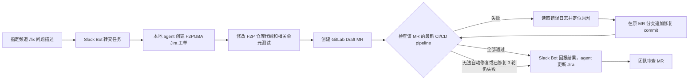

# Chat-to-Fix Agent

**在指定 Slack 频道输入 `/fix 问题描述`，由本地 agent 创建 F2P 工单和 Draft MR，并以 MR 的 pipeline 全部通过为目标持续修复。**

Chat-to-Fix Agent 以指定频道的 `/fix` 命令为入口。Slack Bot 接收命令，并将任务交给 Agent。Agent 在 Jira 的 `F2PGBA` 项目创建工单，在 GitLab 的 `account-platform/free-to-play-pc` 仓库修改代码并创建 Draft MR。它继续观察该 MR 的 CI/CD pipeline：若检查失败，就读取具体错误日志，针对失败原因修改代码，并在**原 MR 分支**追加新 commit。新 pipeline 完成后，它再次检查结果，目标是让当前 MR 的相关检查全部通过。Slack Bot 将进度和结果发回频道中任务消息的 thread。入口行为见 [固定频道命令规格](spec/slack-fix-command.md)。

## 当前状态

截至 2026-11-13，Slack 应用的 Bot scopes 为 `commands`、`chat:write`、`users:read`、`users:read.email`；消息事件已关闭。`/fix` 命令已创建，指定频道尚未配置。工作区及组织安装申请仍显示待审批，Bot OAuth token 尚未取得。本机模拟 Slack 频道已可把 `/fix` 转发给 Agent，并显示其发件箱回复。真实 Slack Bot 的 `/fix` 处理和发件箱转发已实现（`npm run start:slack`），尚未连接真实 Slack；发起人邮箱读取尚未实现。旧私信入口只保留本机模拟（`npm run start:mock-dm`）。`src/chat-to-fix/` 已实现 `/fix` 入口和 CI 修复循环，但真实三方链路尚未验收。根目录的 `package.json` 统一管理 Agent 的依赖和命令。可用 [接入脚本](src/chat-to-fix/README.zh.md#接入现有-gitlabjira-slack-配置)复用现有 GitLab、Jira 和 Slack 变量。早期本地 Node.js 服务曾验证 Jira 工单和评论写入，现已删除；Agent 的真实 GitLab 写入尚未验证。下文描述目标流程，不代表功能已经上线。

## 代码目录

```text
src/
├── chat-to-fix/
│   ├── core/       Agent 主代码：应用、任务流程、适配器和工具
│   ├── bot/src/    从 DS Bot 引入的 Bot 层，保留其内部目录
│   ├── bot/test/   Bot 层测试
│   ├── scripts/    启动、调试和验证脚本
│   ├── test/       Agent 测试
│   └── config/     DSH 配置
├── gitlab/、jira/   Agent 接入准备时使用的连接函数及各自的 test/
├── slackBot/       真实 Slack Bot（/fix 和发件箱转发）、本机模拟频道、旧私信模拟入口及其 test/
└── load-local-env.js  旧入口读取根目录 .env.local 的共用脚本
```

Agent 运行时的 Jira、GitLab 适配器位于 `src/chat-to-fix/core/adapters/`。根目录的 `config/` 保存各服务的接入记录；`src/chat-to-fix/config/` 保存 Agent 的 DSH 运行配置。设计规格和历史资料位于 [文档目录](docs/chat-to-fix/README.md)。

测试放在对应模块的 `test/` 中。运行全部测试用 `npm test`；连接函数、Slack Bot（含本机模拟页面启动）、Agent 和 Bot 层可分别用 `npm run test:connections`、`npm run test:slack-bot`、`npm run test:agent`、`npm run test:agent-bot` 验证。Agent 与 Bot 层之间的测试用 `npm run test:agent-layer` 验证。

## 目标流程



## 计划交付物

| 交付物 | 作用 |
| --- | --- |
| Slack Bot | 接收指定频道的 `/fix` 命令，在任务消息的 thread 中回复工单、MR、CI、修复进度和最终结果。 |
| 模拟 Slack Bot | 本机频道页面接收 `/fix`、转发给 Agent，并显示讨论串进度；旧私信接口仍可单独运行。 |
| Chat-to-Fix Agent | 创建 `F2PGBA` 工单，修改 F2P 代码，创建 Draft MR，读取 CI 失败日志，并在原 MR 持续修复。 |
| 配置文档 | 记录 Slack、GitLab 和 Jira 的接入状态、权限与验证边界。文档不保存密钥值。 |

## 目标任务输出

- 根据 Slack 消息创建的 `F2PGBA` Jira 工单。
- 位于 GitLab F2P 仓库的 Draft MR，包含修复代码和相关单元测试。
- 原 MR 中每轮修复的 commit，以及对应的 pipeline 结果。
- 发回 Slack 和 Jira 的最终结果：全部通过，或明确说明尚未解决的阻塞。

## 目标 Slack 回传

Bot 在指定频道发布任务消息，并在该消息的 thread 中更新关键节点：

| 节点 | 回复内容 |
| --- | --- |
| 已接收 | 确认收到问题，并说明正在创建工单。 |
| 工单已创建 | Jira 工单编号、链接和问题摘要。 |
| MR 已创建 | Draft MR 链接和目标仓库。 |
| CI 检查与修复 | 当前 pipeline 链接、失败检查的简短原因、修复轮次，以及新 commit 链接。 |
| 结束 | 当前 MR 的相关检查是否全部通过；若未通过，给出阻塞原因和需要人工处理的事项。 |

Slack 回复提供链接和结论，不粘贴完整 CI 日志或凭据。

Bot 以当前 MR commit 对应的最新 pipeline 为准。它不能用旧 pipeline 的成功结果宣称修复完成。同一个 MR 最多自动修复 3 轮，每轮追加一个修复 commit 并检查新 pipeline。如果失败无法从日志定位、超出工单范围、无法自动修复，或 3 轮后仍未通过，Bot 停止循环并报告原因。MR 由团队审查和合并。

## 开发原则

当前先打通最小业务闭环。非阻断的细节问题记录后处理，不让局部优化打断主链路。

## 本地环境变量

本机变量使用 [`.env.example`](.env.example) 模板。变量来源、保存方式、优先级和验证结果统一记录在 [本地环境变量配置](config/local-env/README.md)。

## 模拟 Slack Bot

运行 `npm start` 会先启动 Agent，再在后台启动模拟 Slack 页面；命令打印页面地址 `http://127.0.0.1:4001/` 后返回，不会自动打开浏览器。若 Agent 已在 3090 运行，启动命令会验证其健康状态并继续启动页面。重复运行不会再创建一个模拟页面进程。运行 `npm run start:dev` 可启动两者并在当前终端持续显示 Agent 日志；按 Ctrl+C 只结束日志查看，服务继续运行。运行 `npm stop` 停止两者；`npm run stop:agent` 只停止 Agent。若旧进程仍在运行但没有 PID 文件，停止命令会报错，不会声称已停止或结束未知进程。`npm run start:mock-slack` 可单独在前台启动页面。页面模拟一个频道：输入 `/fix 问题描述` 后，模拟 Bot 将任务交给本机 Agent，并显示 Agent 回传的进度。运行 `npm run logs:agent` 可查看 Agent 收到命令时的日志；页面地址显示在 `npm start` 的终端输出中。模拟 Bot 无需 Slack token。**如果 Agent 已连接真实 Jira 和 GitLab，发送命令会触发真实任务。**启动方式和边界见 [模拟 Bot 规格](spec/mock-slack-bot.md)。旧私信测试接口改用 `npm run start:mock-dm`。

模型认证：设置 `ANTHROPIC_API_KEY` 时，四个流程 bot 使用 Anthropic API；未设置时，它们与修复 bot 一样使用已登录的 Claude Code。修改模型或认证方式后，先运行 `npm stop`，再重新启动 Agent。

## 文档分工

| 文档 | 记录内容 | 更新时机 |
| --- | --- | --- |
| [从 Jira 到交付：工作流](plans/from-jira-to-ship-workflow.zh.md) | 最终目标工作流的中文译文、适用边界和原文待澄清处；用来指导开发，不代表当前实现。 | 来源内容或目标流程变化时。 |
| [Plan：实施计划](plans/chat-to-fix-agent.md) | 整体目标、里程碑、验收标准、未完成事项和当前阻塞。已完成的事项从待办中移走，验收标准仍保留。 | Feature 开始、范围或验收标准变化、待办或阻塞变化时。 |
| [Done：已完成事项](plans/done.md) | 已落实并核对的配置、代码和验证结果。记录完成事实，不把待审批或未验证的工作写成完成。 | 一项工作完成且得到验证后，从 Plan 移入 Done。 |
| [Spec：固定频道 `/fix` 入口](spec/slack-fix-command.md) | 当前目标入口的行为、权限、状态和验收标准。其他 Feature 按需在 `spec/` 下建文档。 | 入口行为或验收标准变化时。 |
| [Spec：旧私信入口](spec/slack-dm-entry.md) | 旧版 Bot 的行为和本地测试记录；不作为新入口的验收标准。 | 旧版代码或历史记录需要更正时。 |
| [Spec：模拟 Slack Bot](spec/mock-slack-bot.md) | 本机频道的 `/fix` 转发、讨论串回传和旧私信接口。 | 模拟入口行为改变时。 |
| [Spec：GitLab 连接函数](spec/gitlab-connection.md) | 可复用连接函数、凭据来源、返回值和验证边界。 | GitLab 连接行为改变时。 |
| [Spec：GitLab MR 客户端](spec/gitlab-mr-client.md) | Draft MR 创建与更新规则，以及主、下游 pipeline 的检查规则。 | GitLab MR 或 CI 行为改变时。 |
| [Spec：Jira board 连接](spec/jira-board-connection.md) | 独立只读连接函数、凭据方式和验证边界。 | Jira 连接行为改变时。 |
| [本地环境变量配置](config/local-env/README.md) | 统一记录变量来源、保存方式、读取优先级和本机验证。 | 新增变量或改变本地凭据加载方式时。 |
| [Slack 配置记录](config/slack/README.md) | Slack 应用权限、安装状态和验证步骤；不保存凭据值。 | Slack 配置、权限或安装状态变化后立即更新。 |
| [GitLab 接入记录](config/gitlab/README.md) | GitLab 当前连接方式、已配置的凭据能力和待验证的写入操作；不保存凭据值。 | GitLab 授权或接入方式变化后立即更新。 |
| [Jira 接入记录](config/jira/README.md) | Jira 读取与写入接口的凭据方式、所需权限和待完成的授权；不保存凭据值。 | Jira 授权或接入方式变化后立即更新。 |
| [Chat-to-Fix 文档](docs/chat-to-fix/README.md) | Agent 的设计规格、Slack 接口及历史研究资料；各文件的适用状态见目录索引。 | Agent 设计或接口变化时。 |

每次 Feature 的代码或配置发生变化，都检查并更新受影响的 Plan、Done、Spec 和配置记录。代码与文档尽量在同一次提交中更新；外部系统的独立操作完成后，立即更新并提交文档。功能目标、流程或文档入口变化时，也更新本 README。未验证的结果保留在 Plan，不移入 Done。
