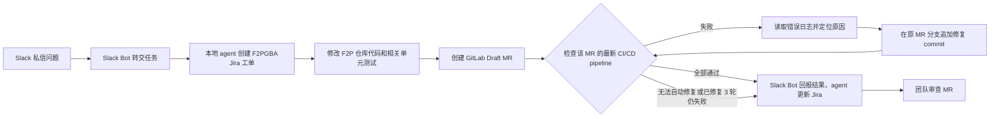

# Chat-to-Fix Agent

**在 Slack 私信描述问题，由本地 agent 创建 F2P 工单和 MR，并以 MR 的 pipeline 全部通过为目标持续修复。**

Chat-to-Fix Agent 以 Slack 私信为入口。Slack Bot 接收问题消息，并将任务交给本地 agent 或服务。本地 agent 或服务在 Jira 的 `F2PGBA` 项目创建工单，在 GitLab 的 `account-platform/free-to-play-pc` 仓库修改代码并创建 Draft MR。它继续观察该 MR 的 CI/CD pipeline：若检查失败，就读取具体错误日志，针对失败原因修改代码，并在**原 MR 分支**追加新 commit。新 pipeline 完成后，它再次检查结果，目标是让当前 MR 的相关检查全部通过。Slack Bot 将进度和结果发回原私信 thread。

## 当前状态

截至 2026-11-11，M0 Slack 私信入口仍在进行中。工作区安装申请已提交，等待管理员批准；Bot OAuth token 尚未取得。仓库已有最小私信测试 Bot，但尚未完成真实私信收发验证。独立的本地 Node.js 服务此前已通过 GitLab 仓库、MR 和 CI 的只读连接验证；连接逻辑现已抽成可供本地 agent 复用的函数，本次重构后尚未做真实连接复测。Jira board 的独立只读连接函数已通过本地测试，但尚未取得 token 或做真实 API 验证。Draft MR 的创建及更新调用已编写，但尚未进行真实写入验证。服务尚未接入 Slack Bot 或本地 agent，也不会自行创建 Jira 工单或 GitLab MR。下文描述的是目标流程，不代表当前功能已经上线。

## 目标流程

## 计划交付物

| 交付物 | 作用 |
| --- | --- |
| Slack Bot | 接收问题消息，在原消息的 thread 中回复工单、MR、CI、修复进度和最终结果。 |
| 本地服务 | 当前提供健康检查、GitLab 仓库连接检查，以及 MR 当前 commit 的 CI 检查结果；后续承接 Bot 任务。 |
| Chat-to-Fix Agent | 创建 `F2PGBA` 工单，修改 F2P 代码，创建 Draft MR，读取 CI 失败日志，并在原 MR 持续修复。 |
| 配置文档 | 当前记录 Slack、GitLab 和 Jira board 的接入状态；后续补齐 Jira 工单和 CI 的接入步骤与验证流程。文档不保存密钥值。 |

## 目标任务输出

- 根据 Slack 消息创建的 `F2PGBA` Jira 工单。
- 位于 GitLab F2P 仓库的 Draft MR，包含修复代码和相关单元测试。
- 原 MR 中每轮修复的 commit，以及对应的 pipeline 结果。
- 发回 Slack 和 Jira 的最终结果：全部通过，或明确说明尚未解决的阻塞。

## 目标 Slack 回传

Bot 在发起任务的 Slack 消息 thread 中更新关键节点：

| 节点 | 回复内容 |
| --- | --- |
| 已接收 | 确认收到问题，并说明正在创建工单。 |
| 工单已创建 | Jira 工单编号、链接和问题摘要。 |
| MR 已创建 | Draft MR 链接和目标仓库。 |
| CI 检查与修复 | 当前 pipeline 链接、失败检查的简短原因、修复轮次，以及新 commit 链接。 |
| 结束 | 当前 MR 的相关检查是否全部通过；若未通过，给出阻塞原因和需要人工处理的事项。 |

Slack 回复提供链接和结论，不粘贴完整 CI 日志或凭据。

Bot 以当前 MR commit 对应的最新 pipeline 为准。它不能用旧 pipeline 的成功结果宣称修复完成。同一个 MR 最多自动修复 3 轮，每轮追加一个修复 commit 并检查新 pipeline。如果失败无法从日志定位、超出工单范围、无法自动修复，或 3 轮后仍未通过，Bot 停止循环并报告原因。MR 由团队审查和合并。

## 开发原则

当前先打通最小业务闭环。非阻断的细节问题记录后处理，不让局部优化打断主链路。

## 文档分工

| 文档 | 记录内容 | 更新时机 |
| --- | --- | --- |
| [Plan：实施计划](plans/chat-to-fix-agent.md) | 整体目标、里程碑、验收标准、未完成事项和当前阻塞。已完成的事项从待办中移走，验收标准仍保留。 | Feature 开始、范围或验收标准变化、待办或阻塞变化时。 |
| [Done：已完成事项](plans/done.md) | 已落实并核对的配置、代码和验证结果。记录完成事实，不把待审批或未验证的工作写成完成。 | 一项工作完成且得到验证后，从 Plan 移入 Done。 |
| [Spec：Slack 私信入口](spec/slack-dm-entry.md) | 一个 Feature 的行为约定，包括输入输出、接口、权限、错误路径和验收场景；区分待实现与已实现行为。其他 Feature 按需在 `spec/` 下建文档。 | 新增 Feature 或改变其行为约定时创建或更新。 |
| [Spec：GitLab 只读服务](spec/gitlab-readonly-server.md) | 本地服务的接口、凭据、错误路径和已验证范围。 | 服务行为改变时。 |
| [Spec：GitLab 连接函数](spec/gitlab-connection.md) | 可复用连接函数、凭据来源、返回值和验证边界。 | GitLab 连接行为改变时。 |
| [Spec：GitLab MR 客户端](spec/gitlab-mr-client.md) | Draft MR 创建与更新规则，以及主、下游 pipeline 的检查规则。 | GitLab MR 或 CI 行为改变时。 |
| [Spec：Jira board 连接](spec/jira-board-connection.md) | 独立只读连接函数、凭据方式和验证边界。 | Jira 连接行为改变时。 |
| [配置记录](config/slack/README.md) | Slack 等外部系统的实际设置、凭据取得位置和验证步骤；不保存凭据值。 | 外部配置、权限、安装状态或启动方法变化后立即更新。 |
| [GitLab 接入记录](config/gitlab/README.md) | GitLab 当前连接方式、已配置的凭据能力和待验证的写入操作；不保存凭据值。 | GitLab 授权或接入方式变化后立即更新。 |
| [Jira 接入记录](config/jira/README.md) | Jira board 当前读取方式、所需权限和待完成的授权；不保存凭据值。 | Jira 授权或接入方式变化后立即更新。 |

每次 Feature 的代码或配置发生变化，都检查并更新受影响的 Plan、Done、Spec 和配置记录。代码与文档尽量在同一次提交中更新；外部系统的独立操作完成后，立即更新并提交文档。功能目标、流程或文档入口变化时，也更新本 README。未验证的结果保留在 Plan，不移入 Done。
