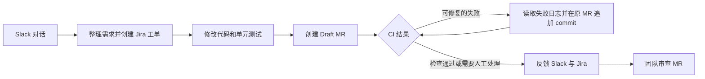

# Chat-to-Fix Agent

**从 Slack 对话出发，交付经过 CI 验证的 Draft MR。**

Chat-to-Fix Agent 计划把团队在 Slack 中提出的代码问题转成可追踪的修复任务。它创建或同步 Jira 工单，修改目标仓库的代码和相关单元测试，提交 Draft MR，并根据 CI 结果在**同一个 MR**中持续修复。完成后，它把 MR、验证结果和未解决的问题反馈到 Slack 与 Jira，供团队审查。

## 目标流程

一次任务应交付：

- 有问题描述和验收条件的 Jira 工单。
- 包含代码、相关单元测试和变更说明的 Draft MR。
- 与 MR 当前 commit 对应的 CI 结果，以及每次修复的记录。
- 发回原 Slack 对话和 Jira 工单的结论。

Agent 只处理能归因于本次改动、且属于工单范围的 CI 失败。信息不足、检查无法读取或达到修复上限时，它停止并说明原因。MR 由团队审查和合并。

## 当前阶段

**这是产品目标，完整流程尚未实现。** 现有 [Rovo CI Relay 实验仓库](https://github.com/whhe-coder/rovo-ci-relay)分别验证了 Jira 工单创建 Draft MR、GitLab Runner 读取真实 job 日志，以及 Runner 向 Studio 发送合成 WebHook 数据。真实 CI 结果送达子 Agent、Slack 入口、本地 Agent 和自动修复循环仍待端到端验证。

当前先打通最小业务闭环。非阻断的细节问题记录后处理，不让局部优化打断主链路。
