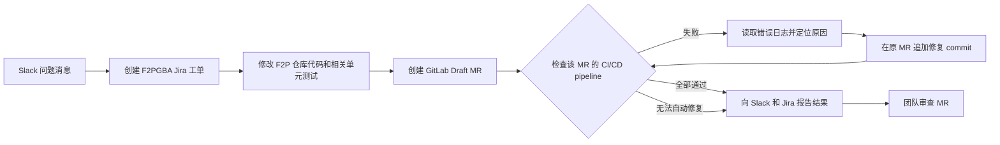

# Chat-to-Fix Agent

**在 Slack 描述问题，由 Bot 创建 F2P 工单和 MR，并持续修复到 MR 的 pipeline 通过。**

Chat-to-Fix Agent 是一个以 Slack 为入口的修复 Bot。用户发送包含问题描述的消息后，Bot 在 Jira 的 `F2PGBA` 项目创建工单，在 GitLab 的 `account-platform/free-to-play-pc` 仓库修改代码并创建 Draft MR。Bot 继续观察该 MR 的 CI/CD pipeline：若检查失败，它读取具体错误日志，针对失败原因修改代码，并在**原 MR 分支**追加新 commit。新 pipeline 完成后，Bot 再次检查结果，重复这个过程，直到当前 MR 的相关检查全部通过。

## 目标流程

## 项目交付物

| 交付物 | 作用 |
| --- | --- |
| Slack Bot | 接收问题消息，展示工单、MR 和修复进度，并把最终结果发回原对话。 |
| Chat-to-Fix Agent | 创建 `F2PGBA` 工单，修改 F2P 代码，创建 Draft MR，读取 CI 失败日志，并在原 MR 持续修复。 |
| 配置文档 | 说明 Slack、Jira、GitLab 和 CI 的接入步骤、权限与变量配置、启动方法，以及如何验证整条流程。文档不保存密钥值。 |

## Bot 每次任务的输出

- 根据 Slack 消息创建的 `F2PGBA` Jira 工单。
- 位于 GitLab F2P 仓库的 Draft MR，包含修复代码和相关单元测试。
- 原 MR 中每轮修复的 commit，以及对应的 pipeline 结果。
- 发回 Slack 和 Jira 的最终结果：全部通过，或明确说明尚未解决的阻塞。

Bot 以当前 MR commit 对应的最新 pipeline 为准。它不能用旧 pipeline 的成功结果宣称修复完成。如果失败无法从日志定位、超出工单范围或无法自动修复，Bot 停止循环并报告原因。MR 由团队审查和合并。

## 当前阶段

**以上是产品目标，完整流程尚未实现。** 现有 [Rovo CI Relay 实验仓库](https://github.com/whhe-coder/rovo-ci-relay)分别验证了 Jira 工单创建 Draft MR、GitLab Runner 读取真实 job 日志，以及 Runner 向 Studio 发送合成 WebHook 数据。Slack Bot、完整的本地 Agent、配置文档、真实 CI 结果回传和原 MR 的自动修复循环仍待交付或端到端验证。

当前先打通最小业务闭环。非阻断的细节问题记录后处理，不让局部优化打断主链路。
