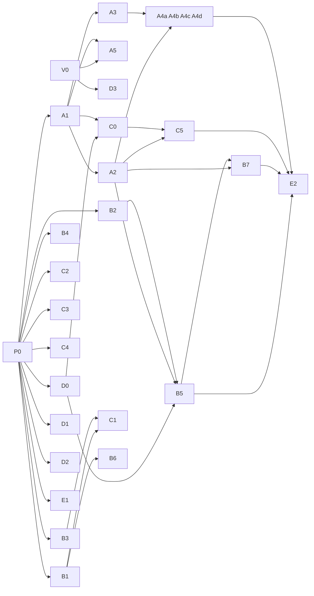

# 自动修复 Bot：开工实现初稿指南

- 日期：2026-11-11
- 用途：把实现拆成可以并行开工的工作包。每个包写明目标、拥有的文件、依赖、要做的事、代码参考和完成标准。
- 前提：软件是什么见 [software-spec.zh.md](software-spec.zh.md)；工具和上限见 [tools-and-limits.zh.md](tools-and-limits.zh.md)。
- 状态：初稿。包的划分和接口约定是提案；下一步是给每个子架构写详细的规格和实现清单。
- 2026-11-12 注：本文已是历史文档，记录最初的工作包划分。包名和接口名（C0、B7、I5 等）仍出现在代码注释里，可以拿本文对照。第 2 节的语言（JavaScript）、目录和 `docker/` 已和代码不符；现状以 software-spec 和 spec-1 至 spec-6 为准。还没做的包：E2 历史问题评测、F1 镜像。
- 代码参考的行号于 2026-11-11 对照源码逐个核实。

## 1. 代码参考的写法

| 前缀 | 指什么 | 位置 |
|---|---|---|
| `DSB:` | DS Bot 0.3.1 的插件源码，路径相对 `ds-bot/` | `~/Documents/mywork/ds-bot/upstream/DS-Bot-0.3.1/ds-bot/` |
| `DSH:` | DeepSeek Harness，提交 `fcc0ad46` | `github.com/deepseek-ai/deepseek-harness` |
| `SA:` | dsh-superagent，提交 `8c32a9d` | `github.com/deepseek-ai/dsh-superagent` |
| `CC:` | Claude Code 命令行参考 | `code.claude.com/docs/en/cli-reference` |
| `规格` | 本目录的 software-spec.zh.md | 章节号 |
| `工具` | 本目录的 tools-and-limits.zh.md | 章节号 |

例：`DSB:src/host/roster.js:140` 指 DS Bot 插件里 roster.js 的第 140 行。

## 2. 工程约定

- 语言和运行环境与 DS Bot 一致：JavaScript（ES 模块）、Node 22.19 以上、`node:test` 做测试。
- 一个文件只属于一个工作包。要改别的包的文件，找那个包的负责人。
- 第 4 节的接口约定由 P0 包负责。任何包要改接口，先改 P0 的约定文件，再通知用到它的包。
- 每个包在自己的分支上做，带测试合入。
- Slack、Jira、GitLab 三个外部系统先用假响应。同事还没有给接入方案，所以每个适配器先做假的实现，真实实现等方案定了再做（R1 包）。工具和任务层只认 I5 的适配器接口，换成真的时不用改。

| 外部系统 | 假响应怎么做 |
|---|---|
| Slack | 讨论是本地的一个文件；回复写进本地的输出文件；@ 事件用一条命令或一次 HTTP 请求模拟 |
| Jira | 单存在本地文件里，单号自增 |
| GitLab | 代码目录是真的：本地 git 仓库加 worktree，Claude Code 改的是真文件，改动是真 diff。推分支推到本地的裸仓库；MR 是本地的一条记录，返回一个假链接 |

目录结构：

```
chat-to-fix/
  index.js                 插件入口                    A2
  package.json                                         P0
  cordis.patch.yml         DSH 配置补丁                D3
  src/bot/                 从 DS Bot 搬来的文件        A1 A3 A4 A5
  src/task/contracts.js    接口约定                    P0
  src/task/botlayer.js     bot 层门面                  A2
  src/task/store.js        任务库                      B1
  src/task/queue.js        队列                        B2
  src/task/gate.js         步骤把关                    B3
  src/task/http.js         监听口和控制接口            B4
  src/task/runner.js       运行器                      B5
  src/task/recorder.js     记录器                      B6
  src/task/monitor.js      监控                        B7
  src/tools/register.js    工具注册框架                C0
  src/tools/task.js        任务工具                    C1
  src/tools/slack.js       Slack 工具                  C2
  src/tools/jira.js        Jira 工具                   C3
  src/tools/repo.js        代码仓库工具                C4
  src/tools/request-code.js                            C5
  src/adapters/            Slack、Jira、仓库的适配器   C2 C3 C4
  src/adapters/fakes/      假适配器                    E1
  src/config.js            配置                        D1
  src/registry/bots.js     bot 注册表                  D0
  src/flow/steps.js        流程定义                    D0
  src/prompts/             五个 bot 的说明、群公告、审查子 agent 的说明   D2
  test/                                                各包自带，E1 负责端到端
  docker/                                              F1
```

## 3. 并行拆解

### 3.1 工作包一览

| 包 | 名称 | 依赖 | 波次 |
|---|---|---|---|
| P0 | 工程骨架和接口约定 | 无 | 0 |
| V0 | 本机演示验证 | 无 | 0 |
| A1 | bot 层：全量拷入和基线测试 | P0 | 1 |
| B1 | 任务库 | P0 | 1 |
| B2 | 队列 | P0 | 1 |
| B3 | 步骤把关 | P0 | 1 |
| B4 | 监听口和控制接口 | P0 | 1 |
| C2 | Slack 适配器和工具 | P0 | 1 |
| C3 | Jira 适配器和工具 | P0 | 1 |
| C4 | 代码仓库适配器和工具 | P0 | 1 |
| D0 | bot 注册表和流程定义 | P0 | 1 |
| D1 | 配置 | P0 | 1 |
| D2 | 提示词和群公告 | P0 | 1 |
| E1 | 假适配器和端到端测试台 | P0 | 1 |
| A2 | bot 层：入口、安装顺序、门面 | A1 | 2 |
| A3 | bot 层：补位文件 | A1 | 2 |
| A5 | Claude Code 驱动修正 | A1、V0 | 2 |
| C0 | 工具注册框架 | A1、D0 | 2 |
| C1 | 任务工具 | B1、B3 | 2 |
| B6 | 记录器 | B1 | 2 |
| D3 | DSH 配置补丁 | V0 | 2 |
| B5 | 运行器 | A2、B1、B2、D0 | 3 |
| B7 | 监控 | A2、B1、B5 | 3 |
| C5 | `request_code` | A2、C0 | 3 |
| A4a | 裁剪 tools.js | A2、A3 | 3 |
| A4b | 裁剪 roster.js | A2、A3 | 3 |
| A4c | 裁剪 parts.js | A2、A3 | 3 |
| A4d | 删除其余模块，改提示词文字 | A2、A3 | 3 |
| E2 | 历史工单评测 | 全部 | 4 |
| R1 | 真实接入 Slack、Jira、GitLab | 同事的方案、C2、C3、C4 | 之后 |
| F1 | 镜像 | 全部 | 之后 |

### 3.2 波次

| 波次 | 可以同时开工的包 | 并行数 | 这一波结束的标志 |
|---|---|---|---|
| 0 | P0、V0 | 2 | 接口约定合入；本机上原版 DS Bot 调通了 Claude Code |
| 1 | A1、B1、B2、B3、B4、C2、C3、C4、D0、D1、D2、E1 | 12 | bot 层原样跑通它自己的测试；任务层各件对着假实现通过各自的测试 |
| 2 | A2、A3、A5、C0、C1、B6、D3 | 7 | 从代码里能建 bot、建群、投一条消息并跑完一轮 |
| 3 | B5、B7、C5、A4a、A4b、A4c、A4d | 7 | 三个外部系统都用假响应，一张历史工单走完七步，本地仓库里有改动和一条 MR 记录 |
| 4 | E2 | 1 | 5 到 10 张历史工单跑完，上限校准完 |

波次 1 能并行到 12 个，是因为这些包只依赖 P0 的接口约定，互相之间用假实现对接。



## 4. 接口约定（P0 的产出）

各包照这些约定各自开发。下面只列名字和形状，详细规格在第 6 节列出的六份细分规格里。

```js
// I1 bot 层门面  src/task/botlayer.js   实现：A2   详见规格 5
createBot({ name, label, instructions, model, permission, preset })   // -> botId
createGroup({ name, memberIds, adminId, notice })                     // -> groupId
setGroupWorkDir(groupId, dir)
postTask(groupId, text, requestId)
askBot({ fromSessionId, toBotId, text })
stopBot(botId)        stopGroup(groupId)
deleteGroup(groupId)  deleteBot(botId)
groupExists(groupId)  isQuiet(groupId)  status()
onGroupLine(fn)  onSessionEvent(fn)  onToolResult(fn)  onRoundEnd(fn)  onApproval(fn)
answerApproval(id, choice)
bindBot(botId, { taskId, role })   unbindBot(botId)
botOfSession(sessionId)                                               // -> { botId, role, taskId }

// I2 任务库  src/task/store.js   实现：B1   详见规格 2
knownEvent(eventId)              createTask(origin, binding)      getTask(id)
findByThread(channel, threadTs)  patchTask(id, patch)
startRun(id, { groupId, bots })  endRun(id, state, endReason)
appendRecord(id, entry)          readRecords(id, { step })        listTasks({ state })

// I3 步骤把关  src/task/gate.js   实现：B3   详见规格 1
advance(taskId, toStep)                    // -> { ok: true } 或 { ok: false, missing }
allow(taskId, toolName, purpose)           // -> { ok: true } 或 { ok: false, reason }
confirmNeedsInfo(taskId, role, text)
close(taskId, outcome, note)               // -> { ok: true } 或 { ok: false, reason }

// I4 工具  src/tools/register.js   实现：C0   详见规格 4
defineRoleTool({ name, roles, write, purpose, description, parameters, run(ctx, args) })
attachRoleTools(agent)        bridgedToolNames(sessionId)
// ctx = { task, role, botId, store, gate, adapters, config, botlayer }

// I5 适配器  src/adapters/   实现：C2 C3 C4，假实现：E1   详见规格 4
slack.readThread(origin)                   slack.reply(origin, purpose, text)
jira.createIssue(binding, fields)          jira.getIssue(key)
jira.addComment(key, text)                 jira.transition(key, status)
repo.prepare(binding, jiraKey, taskNo)     // -> { dir, branch, base }
repo.diff(dir, base)       repo.readFile(dir, path, ref)       repo.log(dir, path, n)
repo.openDraftMR(binding, dir, branch, fields)   // -> url
repo.getMR(binding, branch)                repo.cleanup(dir)

// I6 HTTP  src/task/http.js   实现：B4   详见规格 3
POST /events      GET /tasks/:id      GET /tasks      POST /tasks/:id/stop      GET /health

// I7 bot 注册表和流程定义  src/registry/bots.js  src/flow/steps.js   实现：D0
bots:  [{ name, role, instructions, model, permission, tools }]   // 前五项是 DS Bot 原有的 bot 字段，tools 是新增的
steps: [{ no, name, roles, evidence, writeTools }]
```

另外两项约定是数据形状：任务的字段（规格 8.1）、执行记录每一条的字段（规格 7.6）、配置的键（规格 8.2）。

## 5. 工作包

### P0 工程骨架和接口约定

- **目标**：建好工程和目录，把第 4 节的接口写成约定文件，让其他包可以同时开工。
- **拥有的文件**：`package.json`、`src/task/contracts.js`、测试脚本。
- **做什么**：建目录；写接口的名字、参数和返回形状；配好测试命令；写一份“怎么对着假实现开发”的说明。
- **代码参考**：

| 位置 | 看什么 |
|---|---|
| `DSB:index.js:53` | 插件声明自己依赖哪些 DSH 服务 |
| `DSB:index.js:62`、`:66` | 插件入口的形状：`apply` 和 `createRuntime` |
| `DSB:package.json:46`、`:48` | 测试命令；测试用的 DSH 依赖怎么装 |
| `DSB:test/harness-resolve.mjs` | 测试时怎么找到 DSH 的包 |
| `SA:src/core/ports.ts` | 把对外依赖写成接口的做法 |

- **完成标准**：约定文件合入；空工程能跑测试命令。

### V0 本机演示验证

- **目标**：在本机 Mac 上用未改动的 DS Bot 调通本机已登录的 Claude Code，确定启动参数。
- **拥有的文件**：一份验证记录（不进工程）。
- **做什么**：装 DSH 和 DS Bot；建一个模型选 Claude Code 的 bot 和一个走 Anthropic API 的 bot；在一份测试仓库里让它改一个文件；记下实际可用的启动参数和权限模式。
- **代码参考**：

| 位置 | 看什么 |
|---|---|
| `DSB:src/host/local-agents/claude.js:71` | 启动 Claude Code 的参数 |
| `DSB:src/host/local-agents/engines.js:10`、`:55` | Claude Code 线路的定义；权限预设到命令行模式的对应 |
| `DSB:test/fixtures/fake-claude.mjs` | 测试用的假 claude；真实命令行没有测试覆盖 |
| `CC:` `--input-format`、`--output-format`、`--permission-mode`、`--mcp-config` | 官方参数说明；双向逐行 JSON 的示例带 `-p` |
| `DSH:packages/llm/llm-pi-ai/README.md:56` | Anthropic 线路的配置写法 |

- **完成标准**：Claude Code 通过 bot 改了文件；走 API 的 bot 能回复；参数记录在案。

### A1 bot 层：全量拷入和基线测试

- **目标**：把 DS Bot 的宿主代码原样拷进 `src/bot/`，让它自己的测试在新工程里通过，作为后续裁剪的对照。
- **拥有的文件**：`src/bot/` 的初始内容、搬来的测试。
- **做什么**：拷入 `src/host/` 全部文件和 `src/shared/`；拷入测试和夹具；跑通。
- **代码参考**：

| 位置 | 看什么 |
|---|---|
| `DSB:src/host/` | 要拷的全部宿主文件 |
| `DSB:test/` | 164 个文件；`fake-ctx.js` 是假的 DSH 上下文 |
| `DSB:index.js:60` | 44 个模块的安装顺序 |

- **完成标准**：搬来的测试全部通过。

### A2 bot 层：入口、安装顺序、门面

- **目标**：写新的入口，并实现 I1 门面，让任务层能调用 bot 层。
- **拥有的文件**：`index.js`、`src/task/botlayer.js`。
- **做什么**：写安装顺序；依赖列表去掉“网页连接”；保留内部对象；把 `sendUser` 从被去掉的文件搬进门面；用门面包住建 bot、建群、停止、删除、观察这些函数。
- **代码参考**：

| 位置 | 看什么 |
|---|---|
| `DSB:index.js:66` | 内部对象在这里建好，原入口没有把它留给外面 |
| `DSB:src/host/store.js:25` | 这里在安装时就要用日志函数，所以诊断模块必须先装 |
| `DSB:src/host/resume.js:168` | 这里包裹 `deliver`，所以必须在投递模块之后装 |
| `DSB:src/host/roster.js:140`、`:148` | 建 bot 及其参数 |
| `DSB:src/host/roster.js:493`、`:503` | 建群及其参数 |
| `DSB:src/host/roster.js:579`、`:649`、`:701` | 改群、删群、删 bot |
| `DSB:src/host/channel.js:670` | `sendUser`：以用户身份往 bot 或群里发消息，要搬出来 |
| `DSB:src/host/groups.js:252` | 订阅群里每一行发言 |
| `DSB:src/host/groups.js:1378` | 停止整群 |
| `DSB:src/host/groups.js:1401` | 群里谁在工作、有没有未完成的批次 |
| `DSB:src/host/turns.js:415`、`:462`、`:503` | 三个观察视图 |
| `DSB:src/host/handoffs.js:263`、`:283` | 谁在等谁；一个 bot 的一句话状态 |
| `DSB:src/host/approvals.js:15`、`:100` | 订阅审批事件；应答审批 |
| `DSB:src/host/store.js:494` | 从会话反查是哪个 bot |

- **完成标准**：测试里用门面建两个 bot 和一个群，投一条消息，群里跑完一轮。

### A3 bot 层：补位文件

- **目标**：给被去掉的模块留下的调用点提供替身，使保留的文件在没有那些模块时仍然能跑。
- **拥有的文件**：`src/bot/stubs.js`。
- **做什么**：按下表逐个提供函数；把两个被导入的小函数内联进来。
- **代码参考**：

| 调用位置 | 函数 | 补位 |
|---|---|---|
| `DSB:src/host/delivery.js:84`，`groups.js:290`，`parts.js:817` | `ensureCapabilities` | 空函数 |
| `DSB:src/host/groups.js:1464`，`parts.js:1385`、`:645` | `ownRequest`、`tagUsage` | 保留原语义，见 `DSB:src/host/usage.js:574`–`584` |
| `DSB:src/host/parts.js:695` | `renewMemory` | 空函数 |
| `DSB:src/host/parts.js:982` | `moveSchedules` | 空函数 |
| `DSB:src/host/roster.js:653`、`:706` | `archiveGroupMemory`、`archiveBotMemory` | 空函数 |
| `DSB:src/host/roster.js:741` | `forgetBotSecrets` | 空函数 |
| `DSB:src/host/roster.js:161`，`folders.js:140` | `privateClash` | 返回无冲突 |
| `DSB:src/host/roster.js:331`，`tools.js:429` | `checkPrivacyChange` | 空函数 |
| `DSB:src/host/roster.js:486` | `checkNoPrivate` | 空函数 |
| `DSB:src/host/groups.js:932` | `imagesForGroup` | 返回空列表 |
| `DSB:src/host/turns.js:12` | 导入的 `reminderText` | 内联 |
| `DSB:src/host/parts.js:19` | 导入的 `openTurnAt` | 内联 |

- **完成标准**：只装保留的模块加补位文件时，A2 的测试仍然通过。

### A4a 裁剪 tools.js

- **目标**：只留我们要的团队工具和工具挂载机制。
- **拥有的文件**：`src/bot/tools.js`、`src/bot/constants.js`。
- **代码参考**：

| 位置 | 看什么 |
|---|---|
| `DSB:src/host/tools.js:75`、`:161`、`:292`、`:594` | 保留：`list_bots`、`message_bot`、`stop_bot`、`post_to_group` |
| `DSB:src/host/tools.js:657`、`:716` | 去掉：`ask_user`、`show_view` |
| `DSB:src/host/tools.js:1100` | 去掉：能力相关的工具 |
| `DSB:src/host/tools.js:793`、`:928`、`:959` | 保留：把工具挂到各会话、屏蔽不该有的工具 |
| `DSB:src/host/constants.js:65` | 团队工具名单，删掉已去掉的名字 |

- **完成标准**：bot 的工具列表里只剩保留的工具；相关测试通过。

### A4b 裁剪 roster.js

- **目标**：留下建和删；去掉头像、私密 bot、自动建 Chief；处理 Main 的遗留限制；换预设；不发自动问候。
- **拥有的文件**：`src/bot/roster.js`。
- **代码参考**：

| 位置 | 看什么 |
|---|---|
| `DSB:src/host/roster.js:75` | 新会话固定用 `standard` 预设，这里换成我们的只读预设 |
| `DSB:src/host/roster.js:137`、`:233`、`:243` | “稍后选模型”和自动问候的发出与释放 |
| `DSB:src/host/roster.js:680` | “团队至少要有一个 Main”的检查 |
| `DSB:src/host/roster.js:773` | 自动创建 Chief，去掉 |

- **完成标准**：建 bot 不发问候；任务的五个 bot 都能删除。

### A4c 裁剪 parts.js

- **目标**：留下长对话的分段，去掉界面分页和对已去掉模块的调用。
- **拥有的文件**：`src/bot/parts.js`。
- **代码参考**：`DSB:src/host/parts.js:19`、`:645`、`:695`、`:817`、`:982`、`:1385`（对被去掉模块的调用点）。
- **完成标准**：一段超长对话能切到新的一段并继续。

### A4d 删除其余模块，改提示词文字

- **目标**：删掉不搬的模块文件；把提示词里提到已去掉工具的句子删掉。
- **拥有的文件**：`src/bot/prompt.js`、`src/bot/groups.js` 里的文字常量。
- **代码参考**：

| 位置 | 看什么 |
|---|---|
| `DSB:src/host/prompt.js:4`、`:27` | 团队规则和 Main 规则 |
| `DSB:src/host/groups.js:151`、`:152`、`:166`、`:174` | 群内回复规则、@ 规则、管理员说明、建群问候 |

- **完成标准**：提示词里不再出现不存在的工具名。

### A5 Claude Code 驱动修正

- **目标**：让 Claude Code 接入符合我们的需要：环境变量只放行指定的、能把我们的工具递给它。
- **拥有的文件**：`src/bot/local-agents/`。
- **做什么**：修环境变量读错对象的问题；`cleanEnv` 改成只放行指定变量；去掉对 Codex 和 ACP 驱动的引用；让递给 Claude Code 的工具包含coding bot 的专属工具；启动 Claude Code 时传入审查子 agent 的定义，只给它读和搜索的工具；按 V0 的结果定启动参数。
- **代码参考**：

| 位置 | 看什么 |
|---|---|
| `DSB:src/host/local-agents/claude.js:82` | 读错对象的那一行 |
| `DSB:src/host/local-agents/discover.js:11`、`:15`、`:17` | 被删掉的变量名单；`cleanEnv` |
| `DSB:src/host/local-agents/index.js:12` | 对其他驱动的导入 |
| `DSB:src/host/local-agents/index.js:96` | 递给命令行的工具目前只有团队工具 |
| `DSB:src/host/local-agents/index.js:82` | 权限预设的取法 |
| `DSB:src/host/local-agents/claude.js:129`、`:164` | 权限请求；中断指令 |
| `DSB:src/host/local-agents/adapter.js:435`、`:482` | 权限请求怎么变成审批；只有明确允许才放行 |
| `DSB:src/host/local-agents/mcp.js:30` | 本机 MCP 服务 |
| `CC:` `--agents` | 启动时用 JSON 定义子 agent：它的说明和可用的工具 |
| `CC:` `--tools`、`--disallowedTools` | 限定 Claude Code 可用的内置工具 |
| 规格 5.5、6.5 | 审查子 agent 的规格 |

- **完成标准**：coding bot 的 Claude Code 能看到并调用 `task_read`；它的环境里没有任何集成令牌；审查子 agent 只有读和搜索的工具。

### B1 任务库

- **目标**：保存任务、运行和执行记录。
- **拥有的文件**：`src/task/store.js`。
- **做什么**：每个任务一个目录，一份任务文件和一份逐行记录文件；写入要原子；实现 I2。
- **代码参考**：

| 位置 | 看什么 |
|---|---|
| 规格 8.1、7.6 | 任务的字段；执行记录每一条的字段 |
| `DSB:src/host/store.js:18` 起，`home-lock.js` | 状态文件的原子保存和加锁做法 |
| `SA:src/core/tickets.ts:29` | 工单的状态和规则怎么组织 |
| `SA:docs/001-domain.md` | 工单、派工、输入的关系 |

- **完成标准**：进程重启后任务和记录都在；并发写同一个任务不丢数据。

### B2 队列

- **目标**：按到达顺序排队，控制同时运行的任务数。
- **拥有的文件**：`src/task/queue.js`。
- **代码参考**：

| 位置 | 看什么 |
|---|---|
| 工具 4 | 并发数、队列长度、排队时间的初值 |
| `SA:src/executor/dsh.ts:171` | 名额管理的做法 |
| `SA:docs/003-execution.md` “Concurrency” | 名额什么时候占、什么时候放 |

- **完成标准**：并发数为 1 时严格串行；改成 2 时同时跑两个；超长和超时按上限处理。

### B3 步骤把关

- **目标**：保存任务在第几步，检查完成证据，限制写工具的调用时机。步骤表来自 D0 的流程定义。
- **拥有的文件**：`src/task/gate.js`。
- **代码参考**：

| 位置 | 看什么 |
|---|---|
| 规格 5.2 | 七个步骤、完成证据、每个写工具允许的步骤 |
| 规格 5.5、5.7 | 开 MR 要求审查通过；信息不足要两方确认 |
| `SA:src/core/stage.ts` | 用“从上到下第一条匹配”来定状态的写法 |

- **完成标准**：证据不足时拒绝推进并说明缺什么；写工具在错误的步骤被拒绝。

### B4 监听口和控制接口

- **目标**：接收 @ 事件；提供查任务、列任务、停止任务、健康检查。
- **拥有的文件**：`src/task/http.js`。
- **代码参考**：

| 位置 | 看什么 |
|---|---|
| 规格 7.1、7.8 | 输入字段、处理规则、五个操作 |
| `DSB:src/host/local-agents/mcp.js:30`、`:45` | 在进程里开一个只监听本机、带令牌的 HTTP 服务 |
| `SA:docs/006-deployment.md` “Management API” | 管理接口的设计和错误返回 |

- **完成标准**：同一事件发两次只建一个任务；同一讨论有未结束任务时不建新任务。

### B5 运行器

- **目标**：启动和结束一次运行。
- **拥有的文件**：`src/task/runner.js`。
- **做什么**：按 bot 注册表建五个 bot；建群；把任务发到群里；结束时停止、解散、删除、写结束原因。
- **代码参考**：

| 位置 | 看什么 |
|---|---|
| 规格 5.9 | 启动和解散的顺序 |
| `DSB:src/host/roster.js:148` | 建 bot 能传的参数 |
| `DSB:src/host/roster.js:316` | 建好后设模型和权限 |
| `DSB:src/host/roster.js:503` | 建群：成员、管理员、模式、群公告 |
| `DSB:src/host/groups.js:1149` | 管理员模式下，一条消息先叫到谁 |
| `DSB:src/host/groups.js:286` | 成员在群里的会话是第一次被叫到时才建的 |
| `DSB:src/host/folders.js:29` | 一个会话的工作目录怎么定 |
| `DSB:src/host/permissions.js:55`、`:99` | 设 bot 和群的权限预设 |

- **完成标准**：对着假的 bot 层和真的 bot 层都能建起一次运行并干净地解散。

### B6 记录器

- **目标**：自动生成执行记录。
- **拥有的文件**：`src/task/recorder.js`。
- **代码参考**：

| 位置 | 看什么 |
|---|---|
| 规格 7.6 | 记录的来源和字段 |
| `DSB:src/host/groups.js:252` | 群里每一行发言的订阅 |
| `DSB:src/host/turns.js:627` | 会话事件的订阅：回合开始和结束、工具调用 |
| `DSB:src/host/turns.js:1096` | 工具结果的订阅 |
| `DSB:src/host/approvals.js:15` | 审批事件的订阅 |

- **完成标准**：一次运行结束后，每一步由谁做、调了哪些工具、结果和耗时都能读到。

### B7 监控

- **目标**：检查上限、群是否安静、审批；触发时催促、中断、停止。
- **拥有的文件**：`src/task/monitor.js`。
- **代码参考**：

| 位置 | 看什么 |
|---|---|
| 工具 4 | 全部上限的初值和触发后的动作 |
| 规格 5.8 | 出错和超时的处理表 |
| `DSB:src/host/goals.js:614` | “群已安静”的判断条件 |
| `DSB:src/host/groups.js:1401` | 群里谁在工作、有没有未完成的批次 |
| `DSB:src/host/groups.js:630` | 空转后被暂停的调用放在哪 |
| `DSB:src/host/constants.js:38`、`:78`、`:81` | 成员回复超时、工作宽限、空转上限 |
| `DSB:src/host/groups.js:1353`、`:1378` | 停一个成员；停整群 |
| `DSB:src/host/local-agents/claude.js:164` | 中断 Claude Code |
| `DSB:src/host/approvals.js:100` | 应答审批 |
| `SA:src/limits.ts:2` | 把上限集中成一张表的做法 |

- **完成标准**：每一项上限都有测试：到点触发、动作正确、写进执行记录。

### C0 工具注册框架

- **目标**：按 bot 注册表把工具挂到对应 bot 的会话上；写工具执行前先问步骤把关。
- **拥有的文件**：`src/tools/register.js`。
- **代码参考**：

| 位置 | 看什么 |
|---|---|
| `DSB:src/host/tools.js:793` | 把工具注册到一个会话自己的范围里 |
| `DSB:src/host/tools.js:823` | 走本地命令行的 bot 额外拿到哪些工具 |
| `DSB:src/host/tools.js:994` | 会话建立时触发挂载 |
| `DSB:src/host/tools.js:986` | 在工具执行前拦截的写法 |
| `DSB:src/host/constants.js:65` | 团队工具名单；新工具不要加进去 |
| `DSH:docs/cookbook/adding-a-tool.md` | 定义一个工具的最小写法 |
| `DSH:docs/subsystems/tools.md` | 工具的执行管线和拦截点 |

- **完成标准**：Jira bot 的会话里有 Jira 工具而没有 Slack 工具；写工具在错误步骤被拒绝。

### C1 任务工具

- **目标**：`task_read`、`task_records`、`task_advance`、`task_close`、`needs_info_confirm`、`review_report`。
- **拥有的文件**：`src/tools/task.js`。
- **代码参考**：工具 2.1、2.2、2.6；规格 5.2、5.5、5.7；接口 I2、I3。
- **完成标准**：主 bot 能推进和结束任务；其他 bot 调不到主 bot 的工具。

### C2 Slack 适配器和工具

- **目标**：`slack_read_thread`、`slack_reply`，以及它们背后的适配器。
- **拥有的文件**：`src/tools/slack.js`、`src/adapters/slack.js`。
- **代码参考**：工具 2.3；[questions-for-colleagues.zh.md](questions-for-colleagues.zh.md) 消息一（接口还没约定）。
- **完成标准**：对着假适配器通过；每种用途在一个任务里只发一次。

### C3 Jira 适配器和工具

- **目标**：`jira_create_issue`、`jira_get_issue`、`jira_add_comment`、`jira_transition`。
- **拥有的文件**：`src/tools/jira.js`、`src/adapters/jira.js`。
- **代码参考**：

| 位置 | 看什么 |
|---|---|
| 工具 2.4 | 四个工具 |
| `~/Documents/ChatGPT/ba-fix-bot/research/phase-1/README.md` | 现有的 Jira 自动化规则；新建的单不能触发它 |

- **完成标准**：对着假适配器通过；重复建单返回已有单号；只能碰本任务的单。

### C4 代码仓库适配器和工具

- **目标**：`repo_prepare`、`repo_diff`、`repo_read_file`、`repo_log`、`mr_open_draft`、`mr_get`。
- **拥有的文件**：`src/tools/repo.js`、`src/adapters/repo.js`。
- **代码参考**：

| 位置 | 看什么 |
|---|---|
| 工具 2.5 | 六个工具 |
| 规格 5.2 | 开 MR 前的把关：有改动、审查通过、规模不超限 |
| `SA:docs/003-execution.md` “Preparing a Ticket directory” | 用 git worktree 给每张单建独立目录 |
| `DSB:src/host/roster.js:579` | 把目录设为群的工作目录 |
| `~/Documents/ChatGPT/ba-fix-bot/research/phase-1/README.md` | 现有流程的分支命名、同一分支复用 MR、禁止合并 |

- **完成标准**：在一个本地测试仓库上，准备目录和看改动是真的；推分支推到本地裸仓库，MR 记在本地并返回假链接；重复开 MR 返回已有的。

### C5 `request_code`

- **目标**：coding bot 私下向 Git Pipeline bot 要代码，答复回到coding bot。
- **拥有的文件**：`src/tools/request-code.js`。
- **代码参考**：

| 位置 | 看什么 |
|---|---|
| `DSB:src/host/tools.js:161` | `message_bot` 的实现，是这个工具的样板 |
| `DSB:src/host/tools.js:233` | 不许给上游发消息的检查 |
| `DSB:src/host/handoffs.js:101`、`:224` | 开一件转交的活；把结果拼成答复 |
| `DSB:src/host/turns.js:40`、`:1012` | 一轮结束后把答复送回请求方 |
| `DSB:src/host/delivery.js:58` | 把消息投进某个会话 |
| `DSB:src/host/groups.js:876` | 群里直接 @ 之后主 bot 不被自动叫到，所以这里走私下的路 |

- **完成标准**：coding bot 发出请求后，Git Pipeline bot 的答复回到coding bot 发起请求的那个会话。

### D0 bot 注册表和流程定义

- **目标**：把“有哪些 bot”和“流程怎么走”写成两份互相独立的定义。架构里只有 bot 这一种可注册的东西；流程是另一层。
- **拥有的文件**：`src/registry/bots.js`、`src/flow/steps.js`。
- **做什么**：bot 注册表里每个 bot 一条，字段沿用 DS Bot 的 bot 定义（名字、角色标签、说明、模型线路、权限），只多一项工具清单。流程定义里每一步一条：序号、名称、负责的 bot、完成证据、这一步允许的写工具。运行器、工具注册框架、步骤把关都只读这两份定义，不在自己的代码里写死 bot 或步骤。
- **代码参考**：

| 位置 | 看什么 |
|---|---|
| 规格 3.2 | 架构和流程是两层；一个 bot 对应一个服务 |
| 规格 6.1 至 6.5 | 五个 bot 的定义 |
| 规格 5.2 | 七个步骤、完成证据、每个写工具允许的步骤 |
| `SA:cordis.patch.yml:23`、`:128` | 用配置定义两个固定角色及其工具集的例子 |
| `DSB:src/host/roster.js:148` | 一个 bot 的定义里有哪些字段 |
| `DSB:src/host/roster.js:316` | 建好后设模型和权限 |
| `DSB:src/host/tools.js:823` | DS Bot 默认把同一套团队工具发给所有 bot；按 bot 分配是我们新增的 |

- **完成标准**：加一个 bot 只改注册表；调换两步的顺序或换一步的负责 bot 只改流程定义；两种改动都不用动其他包的代码。

### D1 配置

- **目标**：读配置并校验。
- **拥有的文件**：`src/config.js`。
- **代码参考**：规格 8.2；工具 4。
- **完成标准**：缺必填项时启动失败并说明缺什么；令牌不出现在日志里。

### D2 提示词和群公告

- **目标**：五个 bot 的说明、群公告、审查子 agent 的说明。
- **拥有的文件**：`src/prompts/`。
- **代码参考**：

| 位置 | 看什么 |
|---|---|
| 规格 6.1 至 6.5 | 每个 bot 的职责和说明要点 |
| 规格 5.4、5.6、5.7 | 群公告要写的协作规范 |
| 规格 5.5、6.5 | 审查子 agent 的判断标准 |
| `DSB:src/host/prompt.js:44` | bot 自己的说明和团队规则是怎么拼起来的 |
| `DSB:src/host/groups.js:334` | 群公告加进每个成员提示词的位置 |
| `SA:prompts/orchestrator.md`、`worker.md`、`shared.md` | 路由角色和执行角色的提示词写法 |
| `~/Documents/ChatGPT/ba-fix-bot/research/phase-1/README.md` | 现有修复 Agent V13 的规则，可用于 coding bot 和审查子 agent |

- **完成标准**：七份文字齐全；E1 的端到端测试里 bot 按步骤走。

### D3 DSH 配置补丁

- **目标**：只读预设、Anthropic 模型线路、权限预设、关闭遥测。
- **拥有的文件**：`cordis.patch.yml`。
- **代码参考**：

| 位置 | 看什么 |
|---|---|
| `SA:cordis.patch.yml:125`–`167` | 一个只读预设的完整例子，文件工具关掉写和改 |
| `DSH:packages/preset/agent-preset-registry/src/definition.ts:5` | 预设的定义 |
| `DSH:packages/fs/tool-fs/src/index.ts:31`–`35` | 文件工具的开关 |
| `DSH:packages/llm/llm-pi-ai/README.md:56` | Anthropic 线路 |
| `DSH:packages/bundle/base/cordis.patch.yml:90`、`:135`、`:218`、`:264` | 默认模型、多供应商适配器、遥测、权限这几行的位置 |
| `DSB:docker/docker.patch.yml` | 把审批设为不询问的写法 |

- **完成标准**：走 API 的 bot 没有写文件、命令行、网页工具；遥测关闭。

### E1 假适配器和端到端测试台

- **目标**：不依赖真实的 Slack、Jira、GitLab，就能把一个任务从头跑到尾。演示和开发阶段都用它。
- **拥有的文件**：`src/adapters/fakes/`、`test/e2e/`。
- **做什么**：按第 2 节的表做三个假适配器；做一个模拟 @ 事件的命令；准备一个本地测试仓库和它的裸仓库。
- **代码参考**：

| 位置 | 看什么 |
|---|---|
| `DSB:test/fake-ctx.js` | 假的 DSH 上下文 |
| `DSB:test/fixtures/fake-claude.mjs` | 假的 Claude Code |
| `DSB:test/group-work.test.js`、`rounds.test.js`、`handoff-results.test.js` | 群里干活、轮次、转交结果的测试写法 |
| 规格 5.3、5.7、5.5、5.8 | 要覆盖的场景：正常、信息不足、审查未通过、超时 |

- **完成标准**：四个场景各有一个端到端测试。

### E2 历史工单评测

- **目标**：用真实的历史工单检验修复质量，并校准上限。
- **代码参考**：工具 5；开工方案第 7 节。
- **完成标准**：5 到 10 张历史工单跑完，记录每步耗时和结果，上限按实测重定。

### R1 真实接入 Slack、Jira、GitLab

- **目标**：同事给出接入方案后，把三个假适配器换成真的。
- **拥有的文件**：`src/adapters/slack.js`、`jira.js`、`repo.js` 里的真实实现。
- **依赖**：[questions-for-colleagues.zh.md](questions-for-colleagues.zh.md) 里的问题有了答复。
- **代码参考**：接口 I5；`~/Documents/ChatGPT/ba-fix-bot/research/phase-1/README.md`（现有流程用的 GitLab 项目、分支命名和 Jira 规则）。
- **完成标准**：换成真实适配器后，E1 的四个场景不改测试就能通过；一次真实的 @ 走完全程。

### F1 镜像

- **目标**：部署到公司机器时用的容器镜像。演示阶段不需要。
- **拥有的文件**：`docker/`。
- **代码参考**：`DSB:docker/Dockerfile:11`、`:16`、`:27`；`DSB:docker/entrypoint.sh:45`、`:59`；`DSB:docker/docker.patch.yml`。
- **完成标准**：容器里能跑完一个任务；Claude Code 用公司的 API 密钥。

## 6. 细分规格

每个子架构一份细分规格，里面带实现清单。六份是一起写的，名字和接口互相对得上。

| 序 | 细分规格 | 文件 | 覆盖的包 |
|---|---|---|---|
| 1 | 注册表和流程层 | [spec-1-registry-and-flow.zh.md](spec-1-registry-and-flow.zh.md) | D0、B3、C1 |
| 2 | 状态和存储 | [spec-2-state-and-storage.zh.md](spec-2-state-and-storage.zh.md) | B1、B6 |
| 3 | 看门狗 | [spec-3-watchdog.zh.md](spec-3-watchdog.zh.md) | B2、B4、B5、B7 |
| 4 | 工具和适配器 | [spec-4-tools-and-adapters.zh.md](spec-4-tools-and-adapters.zh.md) | C0、C2、C3、C4、C5、E1 |
| 5 | bot 层搬运 | [spec-5-bot-layer.zh.md](spec-5-bot-layer.zh.md) | A1、A2、A3、A4a–d、A5 |
| 6 | 配置、提示词、验证 | [spec-6-config-prompts-verification.zh.md](spec-6-config-prompts-verification.zh.md) | D1、D2、D3、E2、R1、F1 |

P0 的接口约定由这六份规格里的“接口”一节汇总而成。V0 是一次验证，不单独写规格。

每份细分规格用同一个结构：

1. 范围：管什么，不管什么。
2. 数据形状：字段和例子。
3. 接口：对外提供什么，依赖什么。
4. 行为规则：正常情况和出错情况各怎么处理。
5. 代码参考：精确到文件和行号。
6. 实现清单：一条一条可以勾掉的事项。
7. 验收：怎样算做完。
