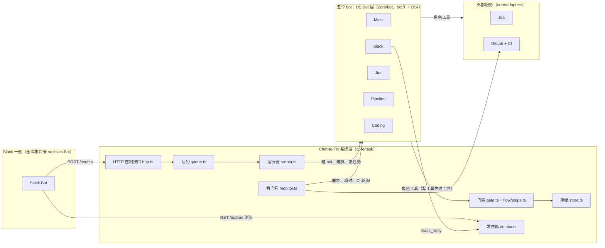
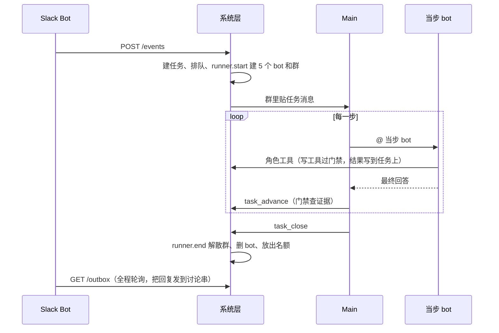

# Chat-to-Fix 架构说明

- 写给第一次看 Agent 代码的人。按 `main` 的提交 `0d80fd3`（2026-11-13）核对过代码。
- 下文代码路径默认相对 `src/chat-to-fix/`，用“文件 + 函数/常量名”指位置，不写行号。

## 1. 一句话

五个 bot 是平级的 agent，跑在 DeepSeek Harness（DSH）上，经过从 DS Bot 裁出来的 bot 层；我们没有自己写 agent 循环。每个 bot 就是注册表 `core/registry/bots.ts` 里的一条，加上提示词 `core/prompts/<role>.md`。这一条决定它用什么模型、什么权限、有哪些工具。系统层只管流程、状态和时限，不替 bot 做判断。

## 2. 分层

| 层 | 是什么 | 在哪 |
|---|---|---|
| Slack 一侧 | 公司 Slack Bot（Yuzhao / Logan 的代码）。把 `/fix` 转成 `POST /events`，轮询 `GET /outbox` 把消息发回讨论串。Chat-to-Fix 在发件箱模式下不连 Slack、没有 Slack token。目前只有本机模拟频道 `src/slackBot/mock-channel.js` 接上了这两个接口，真实的 `src/slackBot/slack-bot.js` 还没接 | 仓库根目录 `src/slackBot/` |
| 系统层 | 不是 bot，是普通代码：接请求、排队、开跑和收尾、计时和催办、检查证据、存任务、攒待发消息 | `core/task/`、`core/flow/` |
| bot 层 | DS Bot 0.3.1 裁剪版，提供 bot、群、bot 之间互相 @ 和 `message_bot` 等团队工具；系统层只通过门面 `core/task/botlayer.ts` `createBotLayer` 调它 | `core/bot/index.ts`、`bot/` |
| 运行时 | DSH，装在仓库根目录（根 `package.json` 的 `@deepseek-ai/dsh*` 依赖），整包使用不改。`scripts/start-chat-to-fix.sh` 启动 DSH，配置补丁 `config/cordis.patch.yml` 把 `core/plugin.ts` 作为插件加载 | 根目录 `node_modules/@deepseek-ai/` |
| 外部服务 | Jira、GitLab（含 CI）、Slack 的适配器，每个有 fake 和 real 两种，Slack 还有 outbox；按配置 `adapters.*` 选 | `core/adapters/index.ts` `createAdapters` |

进程只有一个：DSH 加载 `core/plugin.ts` `apply` → `createChatToFix` 建 bot 层（`core/bot/index.ts` `createRuntime`）和系统层（`core/app.ts` `createApp`），再用 `connectTaskLayer` 把两边接上。

## 3. 五个 bot 是同一种东西

注册表里一条就是一个 bot。字段：`role`、`name`、`label`、`instructions`（提示词文件）、`model`、`permission`、`tools`（只有这个角色有的工具）。Coding 多一个 `reviewer`。`model` 和 `permission` 可以写字面值，也可以写配置键名（`CONFIG_KEYS`：`apiModel`、`codingModel`、`codingPermission`），由 `core/task/runner.ts` 里的 `resolve` 换成配置值。

| role（name） | 模型 | 权限 | DSH 预设 | 专有工具 | 提示词 |
|---|---|---|---|---|---|
| main（Main） | `apiModel` | `read-only` | `readonly` | `task_records` `task_advance` `task_close` `needs_info_confirm` | `main.md` |
| slack（Slack） | `apiModel` | `read-only` | `readonly` | `slack_read_thread` `slack_reply` | `slack.md` |
| jira（Jira） | `apiModel` | `read-only` | `readonly` | `jira_assess_request` `jira_create_issue` `jira_get_issue` `jira_add_comment` `jira_transition` `needs_info_confirm` | `jira.md` |
| pipeline（Pipeline） | `apiModel` | `read-only` | `readonly` | `repo_prepare` `repo_diff` `repo_read_file` `repo_log` `mr_open_draft` `mr_get` `ci_read_log` `mr_push_fix` `ci_stop` | `pipeline.md` |
| coding（Coding） | `codingModel`，默认 `claude-code/default` | `codingPermission`，默认 `workspace-write` | `standard` | `request_code` `review_report` `needs_info_confirm` | `coding.md`；评审子 agent 用 `reviewer.md`，只有 `Read` `Grep` `Glob` |

- 每个 bot 都另有 `task_read`（`core/tools/task.ts`，`roles: 'all'`）和 DS Bot 的团队工具（`message_bot`、`post_to_group`、`stop_bot` 等，名单见 `core/tools/register.ts` `TEAM_TOOL_NAMES`）。
- DSH 预设由 `core/task/runner.ts` `presetOf` 决定：条目里写了 `preset` 就用它，否则 coding 用 `standard`，其余用 `readonly`（`config/cordis.patch.yml` 里的 `preset-readonly`，没有 shell、网络、子 agent 工具）。

**只有一条创建路径。** `core/task/runner.ts` `start()` 对 `allBotDefs()` 逐条做：

1. `botlayer.createBot`：调 DS Bot 的 `rt.createBot`，再用 `rt.updateBot` 设模型和权限；
2. `botlayer.bindBot`：记下 bot 属于哪个任务、哪个角色，并把该角色的工具挂到它的会话上；
3. 全部建完后 `botlayer.createGroup`：五个成员，`mode: 'admin'`，管理员是 Main，群公告是 `core/prompts/group-notice.md`。

五个 bot 没有各自的类，也没有“主 bot 派生子 agent”。它们是一个管理员模式群里的五个平级成员。管理员模式下，普通消息先到 Main，Main 用 @ 叫当步负责的 bot；被叫的 bot 干完给出最终回答就停。唯一的直接互叫在 CI 步：Pipeline 用 `message_bot` 叫 Coding 修。Coding 要仓库别处的代码时用 `request_code`，经 `botlayer.askBot` 私下问 Pipeline。

**工具怎么到 bot 手上。** 工具在 `core/tools/register.ts` 用 `defineRoleTool` 定义一次，`roles` 写哪些角色有它。走 API 的 bot：`attachRoleTools` 把工具注册进它的 DSH 会话（自己的会话在 `bindBot` 时挂，群会话由 `bot/src/host/tools.ts` 里 `shareBotTools` 的钩子挂）。走 Claude Code 的 bot：本机回环 MCP 服务（`bot/src/host/local-agents/mcp.ts`）按 `bridgedToolNames` 把同一批工具提供给 CLI。不管哪条路，执行都经过同一个包装 `call`：取最新任务 → 写工具先问 `gate.allow` → 带重试和超时执行 → 失败返回文字，不抛异常。

**启动自检。** `core/app.ts` `createApp` 一开始跑 `validateRegistry`、`validateFlow`，注册完工具再跑 `tools.validate`（注册表列的工具必须有定义，定义的 `roles` 必须和注册表一致）。对不上就不启动。

## 4. 一个 /fix 走一遍

| 阶段 | 发生什么 | 代码 |
|---|---|---|
| 收到请求 | 校验 token；按频道找绑定（Jira 项目、仓库、测试命令）；建任务；排队 | `core/task/http.ts` `postEvent` → `threadEvent`；`core/config.ts` `bindingOf`；`core/task/store.ts` `createTask`；`core/task/queue.ts` `enqueue` |
| 开跑 | 有空位（`maxConcurrent` 默认 1）就交给运行器：建 5 个 bot、建群、记 run、贴任务消息、开始看守 | `queue.ts` `dispatchNow` → `runner.ts` `start`、`taskMessage`；`botlayer.postTask`；`monitor.watch` |
| 1 fetch | Slack 读讨论串、写总结、回“已收到” | `slack_read_thread`、`slack_reply`（`purpose: ack`） |
| 2 issue | Jira 先用 `jira_assess_request` 判断讨论里有没有具体问题和可检查的结果（要原文引用），通过才 `jira_create_issue`；不通过就走“缺信息” | `core/tools/jira.ts` |
| 3 prepare | Pipeline 建代码目录和分支 `ai/<Jira 单号>`；目录只设成 Coding 的工作目录 | `repo_prepare` → `core/adapters/git.ts`；`botlayer.setGroupWorkDir` |
| 4 code | Coding 在目录里改代码、跑测试，让评审子 agent 看，`review_report` 记结论 | Claude Code CLI，见第 6 节 |
| 5 mr | Pipeline 开 Draft MR（一行 Conventional Commit） | `mr_open_draft`（`core/tools/repo.ts`） |
| 6 ci | 系统轮询 pipeline，失败的 job 自动重跑一次；仍失败就告诉 Pipeline。Pipeline 读日志、叫 Coding 修、`mr_push_fix` 推修复，最多 3 轮（`ciMaxRounds`），或 `ci_stop` 停。结束后系统告诉 Main | `core/task/monitor.ts` `ciCheck` 等；`core/tools/ci.ts` |
| 7 writeback | Jira 评论、改状态；Slack 回结果，写明 CI 过没过 | `jira_add_comment`、`jira_transition`、`slack_reply`（`purpose: result`） |
| 8 close | Main `task_close(done)` | `gate.close` → `runner.end` |
| 收尾 | 停看守、停群里的回合、解散群、删 bot、关 run、必要时发系统通知、放出名额并派下一个 | `core/task/runner.ts` `end` |

所有发往 Slack 的话（bot 的回复、系统通知）在发件箱模式下都追加到 `<dataDir>/outbox.jsonl`（`core/adapters/slack.ts` `createOutboxSlack` → `core/task/outbox.ts`），由 Slack Bot 取走。

**缺信息。** 在 issue 步由 Main 和 Jira 都调用 `needs_info_confirm`，之后的步骤由 Main 和 Coding 都确认（`core/task/gate.ts` `needsInfoPeerRole`）。两方都确认后 Slack 才能发 `purpose: question`，Main 才能以 `needs_info` 结束。

## 5. 谁说了算

原则写在群公告第一句：系统管流程和状态，bot 管内容和判断。

| 系统管 | bot 管 |
|---|---|
| 步骤顺序、每步谁负责、每步要什么证据、哪一步能用哪个写工具（全在 `core/flow/steps.ts` 的数据里） | 每一步具体怎么做：总结写什么、单子怎么写、代码怎么改、评审过不过 |
| 能不能推进、能不能结束（`core/task/gate.ts`） | 什么时候推进、叫谁、以什么结果结束（Main） |
| 时限、催办、超时结束、CI 轮询和计轮、系统通知（`core/task/monitor.ts`） | CI 失败能不能修、要不要停（Pipeline 和 Coding） |
| 任务状态、执行记录、用量（`core/task/store.ts`、`recorder.ts`） | 说明文字（结束说明、MR 描述、Jira 评论） |

门禁怎么卡：

- **推进**：`task_advance` → `gate.advance`。只能进下一步；当前步的证据有缺就拒绝并列出缺什么。证据是任务上的字段，由工具写入，不看聊天文字。比如 issue 步要 `jira.key`，code 步要“有改动”（`diff`）且 `review.verdict == pass`，ci 步要 `ci.settled`。
- **写工具**：`register.ts` `call` 里先 `gate.allow`。不属于当前步的写工具被拒；没在任何一步或 `UNBOUND_WRITE_TOOLS` 登记的写工具也被拒。有的工具还要额外证据（`TOOL_EXTRA_EVIDENCE`）：开 MR 和推 CI 修复都要评审通过、改动在大小上限内（默认 20 个文件、500 行）。
- **结束**：`task_close` → `gate.close`，按 `OUTCOME_RULES` 查：`done` 要在 close 步，`needs_info` 要两方确认加已发问题，`failed`/`needs_person` 要写说明。
- **审批**：任务里的 bot 在 DSH 里触发的、需要人点“允许”的请求，看门狗一律拒绝并记录（`monitor.ts` `onApproval`），所以没有东西会卡着等人。
- 被拒的每一次都写进执行记录（`records.jsonl`），Main 用 `task_records` 能看到原因。

## 6. 例外：Claude Code

模型名的前缀决定走哪条路：`anthropic/...` 走 DSH 自己的模型接口；`claude-code/...` 走 DS Bot 的本机 agent 路由（`bot/src/host/local-agents/`），由它起一个 Claude Code CLI 进程。对 DSH 来说这仍是一个普通 bot 和会话（`LocalAgentAdapter` 是一个 DSH 模型适配器），群、团队工具、审批都照旧；区别是这一轮里的循环由 Claude Code 自己跑。

| 谁 | 什么时候走 CLI | 起进程的参数 |
|---|---|---|
| Coding | 一直（默认 `codingModel` 是 `claude-code/default`） | `bot/src/host/local-agents/launch.ts` `launchFor` → `core/engine/args.ts` `codingArgs`：工作目录内可改文件；shell 只放行 `git status`、`git diff` 和绑定里的测试命令；不弹权限确认；角色工具经 MCP 提供；评审子 agent 用 `--agents` 传入，只读，和 Coding 同模型同 effort；关掉后台任务，保证评审在本轮内答完 |
| 四个流程 bot | `apiModel` 是 `claude-code/...` 时。`npm start` 走 `scripts/connected.ts`：没设 `ANTHROPIC_API_KEY` 就用 `claude-code/claude-sonnet-5-5`（Logan 的提交 `fd4407d`） | `launchFor` → `flowArgs`：内置工具只留 `ToolSearch`，只能调自己的 MCP 角色工具 |

- 评审子 agent 不是注册表里的 bot，只是 Coding 那个 CLI 会话里的一个子 agent。`launchFor` 认的是条目上有没有 `reviewer`，不是角色名。
- 用量：走 API 的 bot 每轮从 DSH 的会话统计取差值（`botlayer.ts` `readTotals`、`roundUsage`），按价目表 `core/task/pricing.ts` 算钱；走 CLI 的回合由 CLI 报用量和费用（`botlayer.reportEngineUsage`）。两者都由 `core/task/recorder.ts` `onUsage` 记到任务上。
- 正在另一个工作区评估一个 DSH 原生的 Coding bot（不走 Claude Code）。如果采用，这个例外就没有了：Coding 也只是注册表里换一个 `model` 和 `tools` 的条目。`main` 上目前没有这部分代码。

## 7. 目录对照

| 目录 / 文件 | 干什么 | 平时要不要看 |
|---|---|---|
| `core/registry/bots.ts` | 注册表：五个 bot 的定义和校验 | 要 |
| `core/prompts/` | 每个角色的提示词、群公告 `group-notice.md`、评审 `reviewer.md`；`index.ts` 读文件 | 要 |
| `core/flow/steps.ts` | 八步、证据、写工具归属、结束规则 | 要 |
| `core/tools/` | 角色工具：`register.ts` 框架，`task.ts`、`slack.ts`、`jira.ts`、`repo.ts`、`ci.ts`、`request-code.ts`；`material.ts` 是公用小函数 | 要 |
| `core/task/` | 系统层：`http.ts`、`queue.ts`、`runner.ts`、`monitor.ts`、`gate.ts`、`store.ts`、`recorder.ts`、`outbox.ts`、`botlayer.ts`（bot 层门面）、`usage.ts`/`pricing.ts`、`contracts.ts`（数据形状） | 要 |
| `core/adapters/` | Jira、GitLab/git、Slack 的 fake/real/outbox 实现 | 接外部服务时看 |
| `core/engine/` | Claude Code 的参数（`args.ts`）、环境与隔离（`env.ts`）、进程驱动（`claude.ts`） | 动 CLI 行为时看 |
| `core/plugin.ts`、`core/app.ts`、`core/config.ts` | 插件入口、系统层组装、配置读取和默认上限（`DEFAULT_LIMITS`） | 偶尔 |
| `core/bot/` | bot 层入口：按顺序装 DS Bot 模块（`index.ts`），加少量替身（`stubs.ts`） | 很少 |
| `bot/` | 从 DS Bot 0.3.1 裁来的代码，基本不改。例外是 `bot/src/host/local-agents/launch.ts`（按角色给 CLI 参数） | 平时不用看 |
| `config/cordis.patch.yml` | DSH 配置补丁：插件行、权限预设、`readonly` 预设 | 很少 |
| `scripts/` | 启停（`start-chat-to-fix.sh` 等）、接真实服务（`connected.ts`）、调试页、端到端脚本；`dev-env.sh` 设本机路径 | 运行时用 |
| `test/` | `npm run test:agent`、`test:agent-layer` | 改代码时跑 |
| `rewrite/` | 从 DS Bot 裁掉了什么、为什么（`INVENTORY.md`） | 想知道 `bot/` 由来时 |
| `docs/chat-to-fix/design/` | 设计和细分规格 1–7 | 改某一块之前 |
| `docs/chat-to-fix/slack/`、`notes/` | 和 Slack Bot 的接口（`slack/slackbot.md`）、早期研究 | 按需 |

## 8. 常见改动去哪改

| 想做什么 | 改哪里 | 注意 |
|---|---|---|
| 加一个 bot | `core/registry/bots.ts` 加一条；`core/prompts/<role>.md` 写提示词；它的工具在 `core/tools/` 用 `defineRoleTool` 定义、`roles` 写上新角色，并在 `core/tools/index.ts` 注册 | 不用新类，`runner.start` 会自动建它、拉进群。它要负责某一步，就在 `steps.ts` 那步的 `roles` 里加上；在 `group-notice.md` 和 `main.md` 里写明 Main 什么时候叫它。代码里按角色名写死的只有三处：`runner.ts` `presetOf`（coding 用 `standard`）、`gate.ts` `needsInfoPeerRole`（issue 步是 jira，其后是 coding）、`validateRegistry` 要求 coding 有 `reviewer` |
| 改一个 bot 的模型 / 权限 | 条目的 `model` / `permission`；或配置里的 `apiModel`、`codingModel`、`codingPermission` | 改认证方式或模型后先 `npm stop` 再启动 |
| 加一个工具 | `core/tools/<服务>.ts` 加定义；注册表对应条目的 `tools` 加名字 | 写工具（`write: true`）必须在 `steps.ts` 某步的 `writeTools` 或 `UNBOUND_WRITE_TOOLS` 登记，否则一调就被门禁拒。名字不能和 DS Bot 团队工具重名 |
| 改一步的规则 | `core/flow/steps.ts`：`STEPS`（顺序、负责角色、证据、写工具）、`TOOL_EXTRA_EVIDENCE`、`OUTCOME_RULES`、`CI_END_REASONS` | 门禁本身不用改，它只读这张表 |
| 改时限、并发、改动上限、CI 轮数 | 配置的 `limits`，默认值在 `core/config.ts` `DEFAULT_LIMITS` | |
| 改提示词 | `core/prompts/*.md`；所有 bot 共用的规则在 `group-notice.md` | 改工具的 `description` 也会影响 bot 行为 |
| 改系统通知文案 | `core/task/monitor.ts` `NOTICE`（英文）、`NOTICE_ZH`（中文，配置 `language: 'zh'` 时用）；`/fix` 开头消息在 `core/task/http.ts` `openingMessage` | |
| 改发件箱 / HTTP 接口 | `core/task/outbox.ts`、`core/task/http.ts` `route`；Slack 适配器 `core/adapters/slack.ts` `createOutboxSlack` | 这是和 Slack Bot 的约定，先改 `docs/chat-to-fix/slack/slackbot.md`，再和 Slack Bot 一侧对齐 |
| 改 Claude Code 怎么起 | `core/engine/args.ts`（`codingArgs`、`flowArgs`）、`bot/src/host/local-agents/launch.ts` `launchFor` | |

## 9. 和设计文档的关系

这份是入口，只讲各部分怎么连起来。每一块的数据形状、接口和规则以 `docs/chat-to-fix/design/` 为准，从 [设计文档索引](design/README.md) 开始：注册表和流程看 spec-1，存储看 spec-2，看门狗看 spec-3，工具和适配器看 spec-4，bot 层看 spec-5，配置和提示词看 spec-6，CI 循环看 spec-7。和 Slack Bot 的接口看 [slack/slackbot.md](slack/slackbot.md)。文档和代码对不上时，以代码为准。
