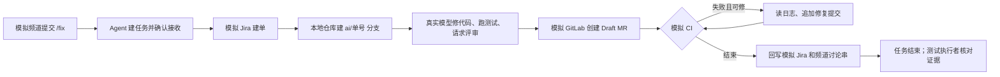

# Chat-to-Fix 当前流程：模拟人工回归指导

| 字段 | 值 |
| --- | --- |
| 状态 | 当前提交的四类本机模拟检查已实跑；延迟可选作业只验证运行中窗口；三轮 CI 修复扩展已通过。结果见[运行记录](runs/2026-11-15-1783a98-manual-regression.md) |
| 文档版本 | 0.1.6 |
| 最后更新 | 2026-11-15 |
| 代码依据 | `1783a98dbc58002496b81ea56154f808771d5500` |

本指南供人工测试员或 AI 助手执行回归：在本机模拟频道提交 `/fix`，观察 Agent 的八步流程，独立检查任务记录、模拟 Jira、模拟 GitLab、本地 Git 分支和回传消息。Agent **调用真实模型并产生费用**；Slack、Jira、GitLab 和目标仓库都使用本机隔离实例。一次运行只测试一个用例，并使用新的运行目录。

> 不用根目录的 `npm start` 做这项回归。它读取现有连接配置；模拟页面提交的任务可能写入真实 Jira 和 GitLab。本指南只启动下文生成并核对过的隔离配置。

## 1. 测试边界与业务流程



| 覆盖 | 不由本指南证明 |
| --- | --- |
| `/fix` 经模拟频道到 Agent 的接口、任务与八步状态 | 真实 Slack 的安装、权限、投递和重试 |
| 真实模型对临时小仓库的修改、测试与评审 | 对真实 F2P 仓库的修复质量 |
| 模拟 Jira、GitLab、CI 的建单、MR、流水线和回写 | 真实 Jira/GitLab API、真实 MR pipeline 的最终状态 |

流程的步骤及门禁以 [`core/flow/steps.ts`](../../src/chat-to-fix/core/flow/steps.ts) 为准；模拟用例以 [`scripts/e2e/cases.ts`](../../src/chat-to-fix/scripts/e2e/cases.ts) 为准。旧交接文档的用例数量和接入状态可能过时。

## 2. 选择执行方式

人工测试员直接从第 3 节开始。使用 AI 助手时，可以把下面这段任务说明交给任意能操作本机浏览器和终端的助手。`<用例>`先选 `copy-typo`；每个后续用例使用新目录。

```text
按 docs/chat-to-fix/manual-regression.md 对当前提交执行一次 <用例> 的模拟人工回归。
你是测试者，不是修复这个 agent 的开发者。先记录 git 提交号，并按文档创建独立运行目录。
启动前核对配置：Slack=outbox、Jira=fake、GitLab=fake、仓库 remote 是本地裸仓库。
只通过模拟页面或文档指定的本机接口提交请求；不要运行 npm start，不要使用真实 Jira/GitLab/Slack。
Agent 调用真实模型会产生费用。记录每个检查点的观察和证据路径；发现失败时保留原始数据，不修改目标仓库来代替 Agent 完成任务。
结束时停止本次启动的模拟页面和 Agent。按第 6 节的格式给出 PASS、FAIL 或 BLOCKED，不能把尚未观察的步骤算作通过。
```

## 3. 每个用例的隔离准备

以下命令从**仓库根目录、同一个终端**执行。先加载本机 Node 路径，确认 Node 为 24，再按需运行 `npm ci`。

```sh
. src/chat-to-fix/scripts/dev-env.sh
node --version
# 首次安装或依赖变化后运行 npm ci
```

准备器和 Agent 启动器都需要 `ANTHROPIC_API_KEY`。密钥只放在本机环境、macOS 钥匙串或仓库已有的 `.env.local`；不要贴进对话、命令输出或回归记录。如果当前环境没有密钥，按现有来源选择一条命令，在**准备用例之前**执行。命令只导出密钥，不显示其值：

```sh
# 已有 macOS 钥匙串条目时
export ANTHROPIC_API_KEY="$(security find-generic-password -a "$USER" -s chat-to-fix-anthropic -w)"
# 或：密钥仅在仓库现有 .env.local 中时（Node 24）
export ANTHROPIC_API_KEY="$(node --env-file=.env.local -p 'process.env.ANTHROPIC_API_KEY ?? ""')"
```

确认 `ANTHROPIC_API_KEY` 非空后，选择当前空闲的本机端口。准备命令会提示 Agent 端口是否占用。每次只准备一个新目录：

```sh
REG_CASE=copy-typo
REG_CHANNEL=C0E2E01
REG_PORT=39090
REG_PAGE_PORT=39091
REG_DIR="$(mktemp -d /private/tmp/chat-to-fix-manual.XXXXXX)"
node src/chat-to-fix/scripts/e2e/run.ts --prepare-only --cases "$REG_CASE" --dir "$REG_DIR" --port "$REG_PORT"
```

`--prepare-only` 只建用例仓库、配置和清单，不启动 Agent。若缺少模型密钥，它仍会写出目录，但以非零状态报告阻塞；不能用同一非空目录重新准备，应换新目录。手动启动前，终端也须已有 `ANTHROPIC_API_KEY`。

准备器默认使用 `fake` Slack。当前 `cases.ts` 的用例都默认采用 `/fix` 命令模式。模拟频道页面通过 Agent 的 `outbox` 显示回复。**在启动前**只改本次运行目录中的配置，并加一个实际执行 `sh test.sh` 的模拟 CI 作业；`ci-changeset` 已自带作业，保留它：

```sh
node --input-type=module - "$REG_DIR/chat-to-fix.json" <<'NODE'
import { readFileSync, writeFileSync } from 'node:fs'
const file = process.argv[2]
const c = JSON.parse(readFileSync(file, 'utf8'))
if (c.adapters.slack !== 'fake' || c.adapters.jira !== 'fake' || c.adapters.gitlab !== 'fake' || c.bindings.length !== 1) {
  throw new Error('不是单用例、全模拟的准备配置')
}
c.adapters.slack = 'outbox'
c.slack = { ...c.slack, inputMode: 'command' }
c.bindings[0].ciJobs ??= [{ name: 'test', command: 'sh test.sh', delaySeconds: 2 }]
writeFileSync(file, JSON.stringify(c, null, 2) + '\n')
NODE
```

测试执行者再核对 `chat-to-fix.json`：`dataDir`、`worktreesDir` 和 `bindings[0].remote` 都位于 `REG_DIR` 下；三个 adapter 分别为 `outbox`、`fake`、`fake`；`bindings[0].testCommands` 是 `sh test.sh`。只报告路径和配置种类，不输出密钥或 `http-token`。准备器的 `e2e-manifest.json` 仍描述原自动套件；本指南按页面和本机文件人工判定，不使用该清单生成自动成绩。

## 4. 启动、提交与观察

启动 Agent 和模拟频道。页面地址只在本机可用。若任一启动命令报端口占用、配置不符或进程归属无法确认，记录 `BLOCKED`，换新目录或端口；不要接管旧进程。

```sh
CHAT_TO_FIX_DATA="$REG_DIR" sh src/chat-to-fix/scripts/start-chat-to-fix.sh
CHAT_TO_FIX_DATA="$REG_DIR" \
MOCK_SLACK_STATE_DIR="$REG_DIR/mock-slack" \
MOCK_SLACK_AGENT_URL="http://127.0.0.1:$REG_PORT" \
CHAT_TO_FIX_SLACK_CHANNEL="$REG_CHANNEL" \
MOCK_SLACK_PORT="$REG_PAGE_PORT" \
node src/slackBot/mock-channel-service.js start
```

测试执行者打开 `http://127.0.0.1:<REG_PAGE_PORT>/`，先确认页面显示 Agent 在线且频道 ID 正确，再输入该用例在 [`CASE_DEFS`](../../src/chat-to-fix/scripts/e2e/cases.ts) 中的 `message`，前面加 `/fix `。例如 `copy-typo`：

```text
/fix 商店首页商品卡片上的购买按钮文案拼错了，现在显示的是 “Purchse”，应该是 “Purchase”（英文界面）。麻烦改一下～
```

页面应显示一条任务消息和讨论串，并给出 `T-n`。页面无法操作时，可用同一模拟频道的本机接口提交；重复提交同一个 `eventId` 用来检查去重：

```sh
curl -sS -X POST "http://127.0.0.1:$REG_PAGE_PORT/api/messages" \
  -H 'Content-Type: application/json' \
  -d '{"eventId":"manual-copy-typo-1","text":"/fix 商店首页商品卡片上的购买按钮文案拼错了，现在显示的是 Purchse，应该是 Purchase。"}'
```

观察任务时，测试执行者使用页面、`show-task.ts` 和本机文件交叉核对。`--follow` 会等到任务终态；先记下每步出现的时间和结果。`REG_DIR` 在新终端中要重新设为刚才的实际目录。

```sh
node src/chat-to-fix/scripts/show-task.ts T-1 --dir "$REG_DIR" --follow
```

| 步骤 | 必须看到的证据 | 本机证据位置 |
| --- | --- | --- |
| 1 `fetch` | 读到请求，频道讨论串有收到确认 | 页面讨论串；任务的 `slack.readAt`、`slack.sent.ack` |
| 2 `issue` | 创建一张对应项目的模拟 Jira 工单；请求含问题与可检查的结果 | 任务 `jira.key`；`fake/jira/issues.json` |
| 3 `prepare` | 建立 `ai/<Jira 单号>` 分支和任务工作目录 | 任务 `repo`；`worktrees/T-n/`；本地裸仓库的 refs |
| 4 `code` | Agent 自己改代码，`run_tests` 通过，评审为 `pass` | 工作目录 diff；任务 `review`；`records.jsonl` |
| 5 `mr` | 一个 `draft: true`、`state: opened` 的 MR，目标为 `master` | 任务 `mr`；`fake/gitlab/mrs.json` |
| 6 `ci` | 当前 MR 提交对应的模拟 CI 已结束；必需作业通过或按日志进入修复 | 任务 `ci`；`fake/gitlab/pipelines.json`；执行记录 |
| 7 `writeback` | 讨论串有最终结果且包含 Jira 单号、MR 链接；Jira 有 MR/结果评论 | 页面讨论串；`outbox.jsonl`；`fake/jira/issues.json` |
| 8 `close` | 状态是 `done`，成功用例的结束原因为 `completed` | 任务 `state`、`endReason`、`runs` |

上表中的相对路径都从 `REG_DIR/chat-to-fix/` 起算。任务文件在 `tasks/T-n/task.json`，执行记录在同级 `records.jsonl`。最终回复出现的时间必须晚于 CI 的真实终态；只看到 `ci.outcome=passed` 不足以证明流水线已经结束。检查当前 MR 的提交 SHA 与任务 `ci.sha`，再核对该 SHA 的作业状态。

`copy-typo` 还须检查：最终只改允许的 `src/locales/en.json`；按钮文案是 `Purchase`；远端只新增任务分支；没有合并 MR；没有把疑似密钥写入评论、回复或提交信息。隐藏测试在 `scripts/e2e/cases/copy-typo/hidden/`；测试执行者可把它复制到**工作目录副本**运行，不能把隐藏测试或 `fix/` 的参考解法交给被测 Agent。

任务结束后，测试执行者可用下列只读检查核对本地分支。`REG_CASE` 和任务号按本次运行替换；每次运行新目录时，任务通常从 `T-1` 开始，但以页面返回值为准。

```sh
git -C "$REG_DIR/chat-to-fix/worktrees/T-1" status --short
git -C "$REG_DIR/chat-to-fix/worktrees/T-1" log --oneline master..HEAD
git --git-dir="$REG_DIR/repos/$REG_CASE/project.git" branch
```

隐藏测试用已有的 `runHidden` 在副本里运行。基准仓库至少有一项失败，Agent 完成后的工作目录应全部通过；这两项都要实际观察。以下命令不修改被测工作目录：

```sh
node --input-type=module - "$REG_DIR" "$REG_CASE" <<'NODE'
import { readFileSync } from 'node:fs'
import { join } from 'node:path'
import { loadCase } from './src/chat-to-fix/scripts/e2e/cases.ts'
import { runHidden } from './src/chat-to-fix/scripts/e2e/workspace.ts'
const [dir, id] = process.argv.slice(2)
const task = JSON.parse(readFileSync(join(dir, 'chat-to-fix/tasks/T-1/task.json'), 'utf8'))
const c = loadCase(id)
const base = runHidden(task.binding.localRepo, c.hiddenFiles, c.hiddenTests)
const head = runHidden(task.repo.dir, c.hiddenFiles, c.hiddenTests)
console.log({ base: base.map(x => [x.file, x.code]), head: head.map(x => [x.file, x.code]) })
if (!base.some(x => x.code !== 0) || head.some(x => x.code !== 0)) process.exitCode = 1
NODE
```

## 5. 回归用例与判定

每个用例重复第 3、4 节，使用新目录、空闲端口和表中的频道 ID。用例输入以 `cases.ts` 为准；不要把 `fix/` 中的参考解法作为 Agent 的提示。

| 用例 | 频道 | 人工关注点 | 通过条件 |
| --- | --- | --- | --- |
| `copy-typo` | `C0E2E01` | 基本 `/fix` → Jira → 修改 → Draft MR → CI → 回报 | 八步完成；CI 的 `test` 作业通过；文案正确；只有一个任务和一个 MR |
| `ci-changeset` | `C0E2E11` | 首次 CI 的 `changeset` 作业失败后的修复循环 | Pipeline bot 读失败日志、叫 Coding bot 修复；原 MR 分支追加提交；新 pipeline 通过；不强推、不新建 MR |
| `needs-info` | `C0E2E12` | 请求缺少按钮位置和新文案 | 第一轮在 `issue` 或 `code` 步骤提具体问题并停在 `needs_info`；在 `issue` 提问时没有 Jira/MR，在 `code` 提问时可能已有 Jira 和分支，但不应有 MR。补充答案后的第二轮另按下段检查 |
| `copy-typo` 加延迟可选作业 | `C0E2E01` | CI 仍有 `allowFailure` 作业运行时的最终通知 | 运行中不得报告整个 pipeline 已通过，不得发送最终“CI 通过”并关闭任务 |

### 三轮 CI 修复扩展

上表的普通 `ci-changeset` 只要求一轮修复。另用**全新**的 `ci-changeset` 运行目录验证三轮：初始 pipeline 失败；Agent 读本轮失败日志、请 Coding 修改、审查并在**同一 MR 分支**推送一个新 fix commit；下一条 pipeline 再失败。这个循环重复三次，第四条 pipeline 才通过。失败作业在同一 pipeline 内的自动重试不算修复轮次。当前代码的 `ciMaxRounds` 默认值为 3，`mr_push_fix` 每次成功推送才把 `ci.round` 加一。

在第 3 节生成并改好这个新目录后、启动前，执行以下命令。门禁脚本只存放在运行目录的 `ci/` 中，不进入被测仓库。它按当前提交距初始仓库的提交数，逐轮报出一个待补的 changeset；提交数保证不能靠一次提交提前补齐三个文件来跳过修复循环。仅此扩展用例把原来的 `changeset` 作业换成 `unit-test` 门禁；普通 `ci-changeset` 保留原作业。

```sh
node --input-type=module - "$REG_DIR" <<'NODE'
import { readFileSync, writeFileSync, mkdirSync } from 'node:fs'
import { join } from 'node:path'
const dir = process.argv[2]
const file = join(dir, 'chat-to-fix.json')
const c = JSON.parse(readFileSync(file, 'utf8'))
if (c.adapters.slack !== 'outbox' || c.adapters.jira !== 'fake' || c.adapters.gitlab !== 'fake' || c.bindings.length !== 1 || c.bindings[0].jiraProject !== 'CICD') throw new Error('隔离配置不符')
const gate = join(dir, 'ci', 'three-round-gate.mjs')
mkdirSync(join(dir, 'ci'), { recursive: true })
writeFileSync(gate, `import { execFileSync } from 'node:child_process'\nimport { existsSync, readFileSync } from 'node:fs'\nconst commits = Number(execFileSync('git', ['rev-list', '--count', 'HEAD'], { encoding: 'utf8' }).trim())\nconst repairs = commits - 2 // 初始仓库提交 + 首次修复提交 = 2\nif (repairs < 0 || repairs > 3) throw new Error('unexpected commit count: ' + commits)\nfor (let i = 1; i <= repairs; i++) {\n  const name = '.changeset/ci-stage-' + i + '.md'\n  if (!existsSync(name) || !/^---\\n[\\s\\S]+\\n---\\n/.test(readFileSync(name, 'utf8'))) {\n    console.error('UNIT-TEST FAILURE: missing valid ' + name + '; add a changeset with YAML front matter and a summary')\n    process.exit(1)\n  }\n}\nif (repairs < 3) {\n  console.error('UNIT-TEST FAILURE: stage ' + (repairs + 1) + ' requires .changeset/ci-stage-' + (repairs + 1) + '.md with YAML front matter and a summary')\n  process.exit(1)\n}\nconsole.log('All three CI repair stages passed')\n`)
c.bindings[0].ciJobs = [{ name: 'unit-test', command: `sh test.sh && node '${gate}'`, delaySeconds: 2 }]
writeFileSync(file, JSON.stringify(c, null, 2) + '\n')
NODE
```

按第 4 节提交原 `ci-changeset` 的 `/fix`，观察至终态。验收时逐一核对：前三条 pipeline 的 `unit-test` 作业失败且分别有日志；`records.jsonl` 有 **3 次** `ci_read_log`、**3 次** Coding 修复和 `mr_push_fix`；每次修复后同一 MR、同一 `ai/CICD-1` 分支出现新提交并继续监控；第四条 pipeline 对第三个 fix commit 通过；`ci.round=3`、任务 `done/completed`。保留四条 pipeline 的 SHA、三个 fix commit 和日志路径。任何一轮未发生，记为未验证或失败，不能用普通用例的一轮结果代替。

`needs-info` 的模拟页面目前没有讨论串回复输入。若要验证 Agent 的第二轮，在第一次到达 `needs_info` 后，从仓库根目录运行下列命令。它从本机文件读接口 token，不打印 token；答复来自该用例的 `followUp.text`。

```sh
node --input-type=module - "$REG_DIR" "$REG_PORT" <<'NODE'
import { readFileSync } from 'node:fs'
const [dir, port] = process.argv.slice(2)
const token = readFileSync(`${dir}/http-token`, 'utf8').trim()
const response = await fetch(`http://127.0.0.1:${port}/tasks/T-1/messages`, {
  method: 'POST',
  headers: { 'content-type': 'application/json', 'x-chat-to-fix-token': token },
  body: JSON.stringify({
    eventId: `manual-answer-${Date.now()}`,
    user: { id: 'UMOCK', name: '模拟用户' },
    text: '是结算页的付款按钮，现在写的是 “Pay now”，改成 “Place order”（首字母大写，o 小写）。其他按钮不要动。',
  }),
})
console.log(response.status, await response.json())
NODE
```

接口应返回同一个任务 ID，随后重新排队。测试执行者须核对 `runs.length=2`、第一轮 `needs_info`、第二轮 `completed`、第二轮读取了答复；还须核对提问前 Main 与该步骤的负责 bot 都确认缺信息（`issue` 对应 Jira，`code` 对应 Coding）。这只证明 Agent 的补充信息接口，不证明真实 Slack 已转发讨论串回复。接口行为见 [`http.ts`](../../src/chat-to-fix/core/task/http.ts)。

延迟可选作业用例在第 3 节改配置后、启动前，从仓库根目录运行下面的命令。`test` 作业通过后、可选作业仍运行时就观察任务；无需等待可选作业的 10 分钟延迟结束。记录两项作业的状态、任务的 `ci.status`、讨论串是否已有最终结果，以及各自时间。当前提交的[本机模拟运行](runs/2026-11-15-1783a98-manual-regression.md)中，`test` 成功后约 78 秒内 `optional-slow` 仍运行，任务保持 `ci/pending`，没有发送“CI 通过”或最终结果；此观察窗口通过。之后手动停止任务，所以**没有验证可选作业结束后的最终结果，也没有复测真实 GitLab**。此前的真实链路问题见[问题记录](../issues/gitlab-optional-job-premature-ci-pass.md)。

```sh
node --input-type=module - "$REG_DIR/chat-to-fix.json" <<'NODE'
import { readFileSync, writeFileSync } from 'node:fs'
const file = process.argv[2]
const c = JSON.parse(readFileSync(file, 'utf8'))
if (c.adapters.slack !== 'outbox' || c.adapters.jira !== 'fake' || c.adapters.gitlab !== 'fake') throw new Error('隔离配置不符')
c.bindings[0].ciJobs.push({ name: 'optional-slow', command: 'true', delaySeconds: 600, allowFailure: true })
writeFileSync(file, JSON.stringify(c, null, 2) + '\n')
NODE
```

遇到超时、模型拒绝、评审未通过、CI 修复耗尽或外部模拟服务错误时，记录实际终态和阻塞原因。不要把“任务结束”自动判为成功。`ci-changeset` 的实际模型行为可能不稳定；若首次提交就包含 changeset，应记为**未覆盖 CI 失败修复路径**，再决定是否重跑。

## 6. 结果记录与收尾

每个用例填一行；任何关键检查没有证据，就写 `BLOCKED` 或 `未验证`，不要写 `PASS`。一份运行记录保存到 [`docs/chat-to-fix/runs/`](runs/README.md)，或先交给用户审阅再保存。

| 字段 | 要记录的内容 |
| --- | --- |
| 环境 | 本地北京时间、Agent 提交号、用例 ID、运行目录、端口、模型名、三个 adapter 种类 |
| 输入 | `/fix` 原文；若有补充信息，记录答复原文 |
| 过程 | 八步各自的结果、任务 ID、Jira 单号、分支、MR、当前提交和 CI 轮次 |
| 结果 | `PASS` / `FAIL` / `BLOCKED`，失败的首个检查点和原因；未验证项单列 |
| 证据 | 任务文件、执行记录、outbox、模拟 Jira/GitLab 文件及相关行或字段；模型费用与用时 |
| 清理 | 两个停止命令的结果；保留运行目录供复核 |

停止**本次**模拟页面和 Agent。若任务仍在运行，可先通过已认证的本机 `POST /tasks/<任务号>/stop` 停止该任务，避免继续调用模型。下列命令从 `REG_DIR/http-token` 读取 token，不输出其值。停止命令按 PID 归属校验，不会接管其他进程。

```sh
node --input-type=module - "$REG_DIR" "$REG_PORT" <<'NODE'
import { readFileSync } from 'node:fs'
const [dir, port] = process.argv.slice(2)
const token = readFileSync(`${dir}/http-token`, 'utf8').trim()
const response = await fetch(`http://127.0.0.1:${port}/tasks/T-1/stop`, {
  method: 'POST', headers: { 'x-chat-to-fix-token': token },
})
console.log(response.status, await response.json())
NODE
```

任务已在终态时，无需调用停止任务接口。接着停止两个进程：

```sh
CHAT_TO_FIX_DATA="$REG_DIR" \
MOCK_SLACK_STATE_DIR="$REG_DIR/mock-slack" \
MOCK_SLACK_PORT="$REG_PAGE_PORT" \
node src/slackBot/mock-channel-service.js stop
CHAT_TO_FIX_DATA="$REG_DIR" sh src/chat-to-fix/scripts/stop-chat-to-fix.sh
```

若停止脚本失败，保留 PID 文件和运行目录，核对 Agent 是否仍在线，并将整次运行标为 `BLOCKED`。在确认进程停止前，不启动下一个用例。

测试数据保留在 `REG_DIR`；先完成记录，再决定是否删除。`npm test`、`npm run typecheck` 和 [`scripts/e2e/run.ts`](../../src/chat-to-fix/scripts/e2e/run.ts) 的自动套件可以补充证据；它们不能代替本指南的模拟页面观察，也不能代替真实三方链路验收。

## 依据与变更记录

| 版本 | 日期 | 变更 |
| --- | --- | --- |
| 0.1.6 | 2026-11-15 | 明确普通 `ci-changeset` 只覆盖一轮修复；增加独立三轮修复扩展，用运行目录外置 `unit-test` 门禁依次触发 3 次失败、读日志、同分支新提交和第 4 条 pipeline 通过。当前提交已实跑该扩展，结果见本轮运行记录。 |
| 0.1.5 | 2026-11-15 | 对齐 `1783a98`：所有模拟用例默认采用 `/fix`；`needs-info` 允许在建单或编码步骤追问，并核对双人确认。当前提交的实际结果待本轮重跑。 |
| 0.1.4 | 2026-11-14 | 按四类本机模拟实跑结果更新状态；纠正延迟可选作业仍是当前已知失败的过时表述，明确只验证运行中窗口。 |
| 0.1.3 | 2026-11-14 | 实跑 `copy-typo` 后补充 `.env.local` 凭据准备顺序、非空目录重试限制和停止失败门禁。 |
| 0.1.2 | 2026-11-14 | 修正任务文件路径，确保隐藏测试检查能读取任务数据。 |
| 0.1.1 | 2026-11-14 | 改为人工测试员与任意 AI 助手共用的操作指南；保留原有模拟范围与验收步骤。 |
| 0.1.0 | 2026-11-14 | 按 `4d00b9f` 的流程、模拟频道、隔离准备器和模拟适配器编写；运行步骤待首次照文档实跑验证。 |

主要依据：[八步门禁](../../src/chat-to-fix/core/flow/steps.ts)、[模拟用例与准备器](../../src/chat-to-fix/scripts/e2e/prepare.ts)、[模拟频道](../../src/slackBot/mock-channel.js)、[Agent 入口](../../src/chat-to-fix/core/task/http.ts)、[模拟 CI](../../src/chat-to-fix/core/adapters/fake/ci.ts)、[任务查看器](../../src/chat-to-fix/scripts/show-task.ts)。
