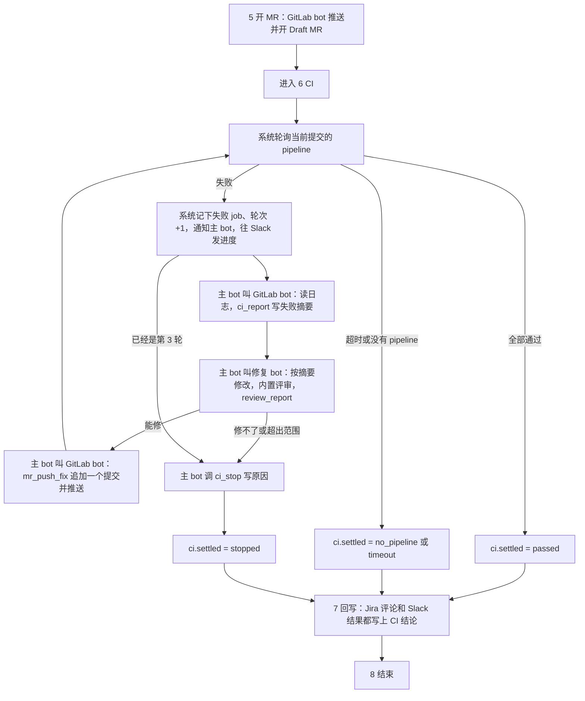

# CI 修复循环：缺口、设计和增量改动

2026-11-12，研究分叉会话写。（2026-11-13：Coding bot 改为 DSH 原生，五个 bot 共用一个 Anthropic API key，Claude Code 路线已删，见 [plan-dsh-coding.md](../design/plan-dsh-coding.md)；本文里 Coding bot 走 Claude Code 的内容只是历史。）只读：没改代码、没提交、没建分支、没启动系统、没调用模型。
对照的代码是 `chat-to-fix/` 的提交 `d1eb5c8`（工作区里另一个子 agent 正在改计费相关文件，本文引用的文件里 `src/task/contracts.ts`、`store.ts`、`config.ts`、`bot/src/host/local-agents/*` 以 `d1eb5c8` 为准）。
参照：公司仓库 `whhe-coder/Chat-to-Fix-Agent` 的 `README.md`「目标流程」、`plans/chat-to-fix-agent.md` 的 M4、`spec/gitlab-mr-client.md`（用 `gh api` 只读）。

## 0. 结论

1. **现在的七步在"开 MR"之后就结束了，CI 一步都没有。** 这不只是少做了一个功能，流程表本身有三处设计疏漏挡着它：流程只能往下一步走、一个写工具只能属于一个步骤、监控按"有人在干活"来计时。所以 CI 循环没法只靠改提示词接上，要动流程表、门禁、监控各一处。
2. **建议新增一步"CI"（第 6 步），放在"开 MR"和"回写"之间，循环在这一步内部完成，不往回跳。** 七步变八步。
3. **分工**：系统负责等 pipeline 和数轮次；GitLab bot 读失败的 job 和日志、写失败摘要、推修复提交；修复 bot 在同一个工作目录里改代码，照旧先过内置评审；主 bot 每轮决定继续还是停。这样仍然是一个服务对一个 bot、系统管流程和状态、没有 `step_done`。
4. **工作量**：一个子 agent 串行做大约 2 到 3 天。先花半小时定接口，然后 4 路并行，再花半天合并和联调，整体大约 1 到 1.5 天。都是估计。
5. **第 5 节的 9 个问题，Zihui 已于 2026-11-12 答复**：Draft MR 会自动触发 CI；pipeline 一般几分钟，具体时长不知道，先用模拟接口；其余 7 条按本文建议。另外定了两条：CI 不过不代表 MR 没价值，所以任务照常以完成结束；修不好时按公司 README 现有说法，最多 3 轮，停止并报告原因。决定汇总在第 5、5.1 节，正文已按决定改好。
6. **想先求最小改动，看第 2.5 节**：最小版大约省掉三分之一，估计并行后整体约 1 天。

## 1. 现在缺什么

### 1.1 设计疏漏：结构上挡着 CI 循环

| # | 问题 | 代码位置 | 影响 |
|---|---|---|---|
| D1 | 流程只能往下一步走，不能回到"写代码" | `src/task/gate.ts:81-86` 只允许推进到 `nextStep` | "失败了回去修"在现有结构里走不通。修复只能放在一个新步骤里，在步骤内部循环 |
| D2 | 一个写工具只能属于一个步骤 | `src/flow/steps.ts:80-88` 返回第一个列了这个工具的步骤；`src/task/gate.ts:115-118` 不在这一步就拒绝 | `review_report` 只能在"写代码"里用，CI 轮次里修复 bot 没法登记评审结论 |
| D3 | `request_code` 写死只能在"写代码"里用 | `src/tools/request-code.ts:19` | CI 轮次里修复 bot 要不到工作目录以外的代码 |
| D4 | 监控按"有人在干活"计时，等 CI 会被误杀 | `src/task/monitor.ts:196` 总时长 80 分钟从运行开始算；`:209-221` "写代码"以外的步骤超时后先催一次、再超时就结束；`:236-251` 群里安静 3 分钟就催，催两次后判卡住 | 等 pipeline 时群里本来就没人说话，几分钟后就会被判"卡住"结束。一条 pipeline 超过 5 分钟，就会触发步骤超时 |
| D5 | 门禁的证据只会判断"有没有值"和"等于某个值"，不会比大小 | `src/task/gate.ts:39-59` | "最多 3 轮"没法写成证据。评审轮数上限现在也没人管：`reviewMaxRounds` 只出现在 `src/config.ts:13`，`src/tools/task.ts:121` 的注释说由监控来管，但 `monitor.ts` 从没读过它。CI 轮数如果只靠提示词限制，会有同样的问题 |
| D6 | 开 MR 时会改写自己的提交并强制推送 | `src/adapters/repo.ts:63-82`（MR 已存在、且没人提交过时用 `--amend`，见第 76 行）；`src/adapters/git.ts:327-332`（`push --force`） | 公司要求每轮在原 MR 分支上"追加"一个修复提交。现在的写法会把上一轮的提交改掉 |
| D7 | 回报按"每个任务发一次"设计 | `src/task/contracts.ts:20` 回复用途只有 ack、question、result；`src/tools/slack.ts:54` 每种用途只发一次 | 公司要求每轮都在 Slack 回报 CI 进度，现在没有地方发 |
| D8 | 修复 bot 的 Claude Code 进程空闲 10 分钟就关闭；重启后不能恢复会话，靠回放 | `bot/src/host/local-agents/adapter.ts:16`；`bot/src/host/local-agents/launch.ts:99-100` | 等 pipeline 基本都超过 10 分钟，所以每一轮修复都会走"重启后回放"这条路径。这条路径从没验证过（旧交接文档 5.4 节） |
| D9 | 一次只跑一个任务，等 CI 时会一直占着名额 | `src/config.ts:14` `maxConcurrent: 1`；`src/task/queue.ts:64` | 一条 pipeline 跑 30 分钟，后面的任务就要排 30 分钟以上；`queueWaitHours: 4` 也可能让排队的任务过期 |

### 1.2 没做的功能

| # | 缺什么 | 代码位置 |
|---|---|---|
| F1 | 读不到 pipeline 的细节。`mr_get` 只返回 MR 状态和一个 pipeline 状态字符串；假 GitLab 里这个值固定是 `none`；真实适配器读的是 `head_pipeline`，可能是旧提交的 | `src/tools/repo.ts:184-198`；`src/adapters/repo.ts:110,117-121`；`src/adapters/gitlab-http.ts:193-202` |
| F2 | 没有"按当前提交找 pipeline"、下游 pipeline、失败的 job 列表、job 日志 | 适配器和工具里都没有 |
| F3 | 任务上没有 CI 字段；只存了 MR 链接，没存 MR 的编号（iid） | `src/task/store.ts:52-74`（`mr: null`）；`src/tools/repo.ts:180` 只存 `{ url }` |
| F4 | 提示词只写了七步，没有一句讲 CI | `src/prompts/group-notice.md`、`main.md`、`pipeline.md`、`coding.md` |
| F5 | 测试、调试页、测试集都按七步写死 | `scripts/e2e/checks.ts:10`（`EXPECTED_STEPS`）；`scripts/flow-page.ts:39`（`STEP_LIST`）；`test/` 下约 9 个文件提到步骤名 |

## 2. 设计

### 2.1 放在哪一步：新增第 6 步"CI"

```
1 取讨论 → 2 建工单 → 3 准备代码 → 4 写代码 → 5 开 MR → 6 CI（新）→ 7 回写 → 8 结束
```

为什么不扩展"开 MR"这一步：
- "开 MR"的完成证据是"有 MR 链接"，CI 的完成证据是"CI 有结论"，两者不同。合在一起，就不知道 CI 卡住时任务卡在哪一步。
- 两步的时间特点完全不同："开 MR"几十秒，CI 要等几十分钟。拆开后，监控可以单独给 CI 一套时间规则。
- 循环放在这一步内部，不往回跳，D1 那条"只能往下走"的规则可以保持不变。

步骤定义（写在 `src/flow/steps.ts`）：

```
{ no: 6, id: 'ci', roles: ['pipeline', 'coding'], evidence: ['ci.settled'],
  writeTools: ['ci_report', 'mr_push_fix', 'review_report', 'ci_stop'] }
```

"回写"变成第 7 步，"结束"变成第 8 步。

### 2.2 谁负责

| 谁 | 做什么 | 为什么 |
|---|---|---|
| **系统**（新模块 `src/task/ci-watch.ts`） | 轮询 pipeline 状态、等结果、记下每轮的状态和失败的 job 列表、数轮次；有结论后通知主 bot；每轮往 Slack 发一条进度 | 等待和计数都是流程状态，按已定设计归系统管。系统来等不花模型 token，也不会被"群里安静"误判。状态由系统数，比靠提示词数可靠 |
| **GitLab bot** | 读失败 job 的日志，写一段失败摘要存到任务上（`ci_report`）；修好后把修复作为一个新提交追加并推送（`mr_push_fix`） | GitLab 归它，一个服务对一个 bot。读日志和推送都碰 GitLab |
| **修复 bot** | 按任务上的失败摘要，在同一个工作目录里改代码，照旧过内置评审，再登记评审结论；判断能不能修、是不是超出工单范围 | 改代码归它，评审也内置在它里面。它不直接读 GitLab，日志经任务交过去，和现在"摘要经任务交接"的做法一致 |
| **主 bot** | 每轮在 GitLab bot、修复 bot、GitLab bot 之间推进；修复 bot 说修不了时，或轮次用完时，调用 `ci_stop` 写明原因；有结论后推进到回写 | 主 bot 本来就负责推进和判断，不新增职责 |

不选的几种做法：
- **让 GitLab bot 自己轮询等 pipeline**：每轮询一次都是一次模型调用，费钱，还会被监控判成没人干活。
- **让修复 bot 直接读 GitLab 日志**：违反一个服务对一个 bot。
- **让系统直接读日志、直接给修复 bot 发消息，跳过 GitLab bot**：最省调用，但"读外部服务的内容并写摘要"在现有设计里一直是 bot 的事（参照 Slack bot 读讨论、写摘要），系统只管等和数。如果你更看重省钱，可以改成这种做法，第 5 节列为待定。

### 2.3 一轮怎么走



### 2.4 具体规则

**当前提交和 pipeline 的选取**（照公司规格 `spec/gitlab-mr-client.md`）
- 只看 MR 当前 `sha` 的 pipeline。`head_pipeline` 如果属于旧提交，就找当前 `sha` 的 MR pipeline，取 ID 最大的那条；找不到就算"还在等"，不借用旧提交的通过结果。
- 主 pipeline 里的 trigger job 要跟到下游 pipeline。下游有失败，就不算通过。
- 主 pipeline 和下游 pipeline 全部成功、且没有失败的 job，才算通过；取消算失败。
- 和公司规格不同的一处（已定）：**`allow_failure: true` 的 job 失败了，不算失败。** 公司规格写的是"只要有失败 job 就返回失败"，那样一个允许失败的 job 就会触发白白修一轮。GitLab 的 job 接口有 `allow_failure` 字段，可以直接判断。
- 不稳定的 job（已定）：同一个提交上某个 job 第一次失败时，系统自动重跑失败的 job 一次（GitLab 的 job retry 接口）。重跑后还失败，才算这一轮失败、交给 bot 去修。重跑由系统做，不算轮次，也不花模型调用。

**等多久、监控怎么放宽**
- pipeline 一般几分钟，具体时长还不知道（已定：先用模拟接口，见第 4 节）。所以时间都做成配置项，先给保守的默认值，接上真实 GitLab 后按实际耗时再调。
- 新配置项：`ciPollSeconds`（默认 15）、`ciWaitMinutes`（单条 pipeline 最多等多久，默认 30）、`ciTotalMinutes`（所有轮次合计最多等多久，默认 90）、`ciMaxRounds`（默认 3）、`stepMinutes.ci`（"有 bot 在干活"的部分的时间上限）。
- 系统在等 pipeline 时（`ci.status = pending`），监控跳过三项检查：步骤超时、群里安静、总时长。等待的时间单独计，由 `ciWaitMinutes` 管。
- 一轮里 bot 在干活的部分（读日志、改代码、推送），照常按步骤超时和群里安静来查，评审仍受"写代码"的时间上限约束。
- 总时长改成"去掉等 CI 的时间后不超过 80 分钟"，等 CI 的时间由 `ciTotalMinutes` 单独管。

**3 轮由谁数**
- 系统数。`mr_push_fix` 每成功一次，`ci.round` 加 1。
- 门禁加一种证据：数值比较，例如 `ci.round < limits.ciMaxRounds`。轮次用完时门禁拒绝 `mr_push_fix`，并写进执行记录。
- 同一个机制顺便把评审轮数上限管起来，补上 D5 那个漏洞。

**证据怎么进门禁**

| 门禁 | 证据 |
|---|---|
| `ci_report`（GitLab bot） | `ci.status == failed`，并且这一轮还没写过摘要 |
| `review_report`（修复 bot，在 CI 步骤里） | 这一轮已有失败摘要 |
| `mr_push_fix`（GitLab bot） | 工作目录有未提交的改动（新证据 `dirty`，读 `git status`）；这一轮的评审结论是通过（评审记录带上轮次号，不能拿上一轮的结论充数）；改动在大小上限以内；`ci.round < ciMaxRounds` |
| `ci_stop`（主 bot） | 要写原因 |
| 推进到回写 | `ci.settled` 有值：passed、stopped、no_pipeline 或 timeout |

`review_report` 要能同时属于"写代码"和"CI"两步。改法：把 `stepOfWriteTool` 改成"当前步骤列了这个工具就放行"，不再返回第一个匹配的步骤（D2）。`request_code` 同理放开到 CI 步骤（D3）。

**提交怎么推**
- 新增 `mr_push_fix`：每轮追加一个新提交，提交信息是一行的 Conventional Commit（例如 `fix(ci): …`），普通推送，不加 `--force`，不改写上一轮的提交（D6）。
- `mr_open_draft` 第一次开 MR 时的做法不变。

**Draft MR 会不会触发 pipeline**
- 已定：会，Draft MR 推送后 CI 自动跑。
- 设计上仍兜住"始终没有 pipeline"：等满 `ciWaitMinutes` 还没有，就判 `no_pipeline`，进入回写，如实回报"没有触发 CI"，不开始修复轮次。

**什么时候回报**
- **Slack**（已定：系统直接发）：每轮出结果时，系统发一条进度通知：第几轮、哪几个 job 失败、pipeline 链接、新提交链接；不贴日志。最终结果仍由 Slack bot 在回写时发，带上 CI 结论。系统进度通知走现有的系统通知通道（`src/task/monitor.ts:269-282` 的 `notify` 和 `send`），不花模型调用，也不用给 `slack_reply` 加新用途。
- **Jira**（已定）：只在回写时写一条评论，带 CI 结论和轮次。CI 通过才流转到"In Review"；CI 没过就不流转，只写评论说明情况。这一条要写进门禁：`jira_transition` 在 CI 未通过时拒绝。

**CI 没过怎么收尾**（Zihui 2026-11-12：CI 不过不代表 MR 没价值）
- CI 不过时，MR 照样是交付物：修复代码在里面，团队可以接着改。所以 CI 没过不算任务失败。
- 3 轮后仍失败、修复 bot 说修不了、或者没触发 CI：照样进入回写，然后以 `done` 结束。结束原因写明 CI 结论，例如 `completed_ci_failed`、`completed_ci_stopped`、`completed_no_ci`；CI 通过时是 `completed`。任务上的 `ci.outcome` 和执行记录里都有结论，调试页和测试集报告据此区分"MR 已交付且 CI 通过"和"MR 已交付、CI 未通过"。
- Slack 和 Jira 的说法也按这个口径："Draft MR 已开，修复在里面；CI 第 N 轮仍有这些 job 失败，需要人看一下"，而不是"任务失败"。Jira 照已定规则：CI 没过不流转，只写评论。
- MR 保留为 Draft，不关闭，修复提交都保留。
- 只有在 MR 本身都没开出来时（前五步失败），任务才算失败。
- **这条分支（无法自动修复，或修了 3 轮仍失败）之后怎么处理，以后还要讨论；第一版按公司 README 现有的说法：停止循环并报告原因。** 四种停止原因和以后可讨论的选项见第 5.1 节。

**修复 bot 空闲关闭（D8）**
- 每一轮给修复 bot 的请求要自带全部上下文：失败摘要、上一轮改了什么，都写在任务上，`task_read` 一次就能拿到。这样即使进程关闭后回放失败，也不影响修复。
- 先用假的 Claude Code 命令行测"空闲关闭、重启、回放"这条路径（不花钱），再在真实运行里验证一次。

**一次只跑一个任务（D9）**
- 第一版：任务一直占着运行名额，直到 CI 有结论。最简单，能用，代价是排队变长。
- 以后：等 CI 时让任务"停靠"，释放名额，有结论再接着跑。这要新增任务状态，每轮新开一次运行，工作量大，不建议放在第一版。

## 2.5 最小版：哪些可以先不做

第 3 节是"做完整"的清单。如果先求最小改动，可以去掉或改简下面这些，核心循环不受影响：

| 完整版 | 最小版 | 省掉什么 |
|---|---|---|
| GitLab bot 用新工具 `ci_report` 写失败摘要 | 不加这个工具。GitLab bot 这一轮的最终回答，就是失败摘要。现有机制已经会把负责这一步的 bot 的回答存成步骤结果（`src/task/recorder.ts` 的 `onRoundEnd`），修复 bot 用 `task_read` 就能读到 | 一个写工具和它的门禁 |
| 门禁加"数值比较"证据来管 3 轮 | 由 `mr_push_fix` 工具自己检查轮次，用完就拒绝，像 `slack_reply` 自己检查"每种用途只发一次"那样（`src/tools/slack.ts:54`） | 门禁求值器的改动 |
| 评审记录带轮次号，防止拿上一轮的结论充数 | 系统每次记下新的失败时，把任务上的评审结论清空。这样 `review.verdict == pass` 只可能来自这一轮 | 评审轮次号和对应的证据 |
| 新证据 `dirty`（有没有未提交的改动） | 不加。没有改动时，`pushFix` 自己报"没有可提交的改动"，和 `openDraftMR` 现在的做法一样（`src/adapters/repo.ts` 的 `nothing_to_commit`） | 一种证据 |
| `jira_transition` 在 CI 未通过时由门禁拒绝 | 先只写进 Jira bot 的提示词 | 一处门禁 |
| 调试页、终端视图加 CI 的专门显示 | 先不改。新记录会按"未知记录"显示成灰色，不会出错 | 外围组 D 的大半 |
| 顺便执行评审轮数上限 | 另开一个小改动 | 一处门禁 |

最小版仍然要做、省不掉的：
1. 步骤表加一步，并让一个写工具能属于多个步骤（D1、D2），约十几行；
2. 系统等待：轮询、重跑一次、记结果、清空评审、通知主 bot、Slack 发进度；
3. 监控在等待时跳过三项检查（D4）；
4. 适配器：`getChecks`、`getJobLog`、`retryJobs`、`pushFix`，以及模拟接口；
5. 三个工具：`ci_read_log`（读）、`mr_push_fix`（写）、`ci_stop`（写）；
6. 提示词；
7. 测试。

最小版估计：一个子 agent 串行约 1.5 到 2 天，并行后整体约 1 天。都是估计。其中大头是适配器加模拟接口、系统等待加监控、测试，这三块无论哪种做法都要做。

## 3. 增量改动清单（完整版）

先花约半小时定接口：任务上的 `ci` 字段、适配器函数签名、步骤表里的新条目、工具名和参数。定好后分 4 路并行，最后由一路改提示词、补端到端测试、联调。

| 组 | 文件 | 改什么 | 估计 | 并行 |
|---|---|---|---|---|
| 0 接口 | `src/task/contracts.ts`、`src/flow/steps.ts` | 步骤列表加 `ci`；任务 `ci` 字段的形状：`{ status, round, sha, pipelineUrl, pipelines, failedJobs, retried, rounds: [{ no, failure, review, commit }], settled, outcome, reason }`；记录类型加 `ci`（系统写的 CI 状态变化） | 小 | 先做 |
| A 适配器 | `src/adapters/gitlab-http.ts`、`src/adapters/repo.ts`、`src/adapters/git.ts`、新 `src/adapters/fake/ci.ts` | `getChecks(binding, branch)`（按当前 sha 找 pipeline，跟下游，排除 allow_failure）；`retryJobs(binding, jobIds)`（重跑失败的 job）；`getJobLog(binding, jobId, { maxChars })`（取末尾、去掉颜色控制符）；`pushFix(...)`（追加提交、普通推送）；`status(dir)`（判断有没有未提交的改动）；任务存下 MR 的 iid。模拟接口见第 4 节 | 中到大 | 与 B、C、D 并行 |
| B 流程和工具 | `src/task/gate.ts`、`src/flow/steps.ts`、`src/task/store.ts`、`src/tools/repo.ts` 或新 `src/tools/ci.ts`、`src/tools/task.ts`、`src/tools/jira.ts`、`src/tools/request-code.ts`、`src/registry/bots.ts` | 一个工具可属于多步；数值比较证据；`dirty` 证据；新工具：`ci_status`（读）、`ci_read_log`（读）、`ci_report`（写）、`mr_push_fix`（写）、`ci_stop`（写）；`review_report` 记录轮次；`taskView` 显示 `ci`；`request_code` 放开到 CI 步骤；`jira_transition` 在 CI 未通过时拒绝；顺便执行评审轮数上限 | 中 | 与 A、C、D 并行 |
| C 系统等待和监控 | 新 `src/task/ci-watch.ts`、`src/task/monitor.ts`、`src/config.ts`、`src/app.ts` | 轮询；第一次失败时自动重跑一次；记录、通知主 bot、往 Slack 发进度；监控在等待时跳过三项检查；新配置项和校验；接线 | 中 | 与 A、B、D 并行 |
| D 外围 | `scripts/flow-page.ts`、`scripts/debug-ui/chat.ts`、`scripts/watch.ts`、`scripts/show-task.ts`、`scripts/e2e/checks.ts` | 八步；调试页加 CI 的箭头（系统 → GitLab bot，标"CI 第 N 轮失败"）；测试集的步骤检查改成八步，加 CI 相关检查 | 小到中 | 与 A、B、C 并行 |
| E 提示词 | `src/prompts/group-notice.md`、`main.md`、`pipeline.md`、`coding.md`、`slack.md`、`jira.md` | 八步；主 bot 的轮次推进和停止规则；GitLab bot 读日志、写摘要、追加提交；修复 bot 按日志修、不扩大范围、不能放宽 CI 或改阈值来"修"（公司 V13 规则），只修 lint、类型这类问题时不必补单元测试，改了行为才要补；回写时写 CI 结论，CI 没过时 Jira 不流转 | 小 | 在 B 之后 |
| F 测试 | `test/` 下约 9 个提到步骤的文件、新 `test/ci-watch.test.ts`、`test/e2e.test.ts` 加场景 | 一次通过；失败、修复、通过；3 轮用完；修不了停下；没有 pipeline；等待时不被监控误杀；空闲关闭后回放 | 中 | 各组自带单元测试，最后一路补端到端 |

合计：一个子 agent 串行做约 2 到 3 天；按上面并行，整体约 1 到 1.5 天。都是估计。

## 4. 测试怎么做：模拟 CI 接口

已定：pipeline 的真实时长不知道，先用模拟接口，等接上真实 GitLab 再按实际调参数。

假 GitLab 加一个"本机 CI"：每次推送到任务分支后，在一个临时检出目录里，对推送的那个提交跑绑定上配置的 CI 命令（新配置项 `ciCommands`，例如 `["sh test.sh", "node hidden-test.js"]`）。每条命令算一个 job，输出就是 job 日志，存到 `<dataDir>/fake/gitlab/pipelines.json`。

模拟接口还要能做这几件事，用来覆盖真实情况：
- **耗时**：每个 job 可设延迟（例如 `ciDelaySeconds`），测"等待时不被监控误杀"和超时。
- **下游 pipeline**：一个 job 可声明为 trigger job，结果放在下游 pipeline 里。
- **allow_failure**：一个 job 可声明允许失败，测它失败时不触发修复。
- **不稳定**：一个 job 可声明"第一次失败、重跑通过"，测自动重跑一次。
- **不触发**：可设成推送后不产生 pipeline，测 `no_pipeline`。

这样做的好处：
- 不连 GitLab 就能把"失败、读日志、修、再推、再判"整个循环真实跑一遍。
- 现有测试集可以直接加 CI 用例。比如仓库里的 `test.sh` 通过，但 CI 命令里的另一项检查（lint、隐藏测试）不通过，正好检验修复 bot 能不能按日志修好。
- 单元测试另外用"脚本化的结果"：按提交预先写好通过还是失败，不跑命令，速度快。

模拟接口的返回形状要和真实 `getChecks` / `getJobLog` / `retryJobs` 一致，这样接真实 GitLab 时只换适配器。

## 5. 决定（Zihui，2026-11-12）

| # | 问题 | 决定 |
|---|---|---|
| 1 | Draft MR 会不会触发 pipeline | 会，CI 自动跑。仍保留"没有 pipeline"的兜底 |
| 2 | 一条 pipeline 跑多久 | 一般几分钟，具体不知道。先用模拟接口（第 4 节）；时间都做成配置项，接上真实 GitLab 后再调 |
| 3 | `allow_failure` 的 job 失败算不算失败 | 不算 |
| 4 | 不稳定的 job | 系统自动重跑一次，还失败才算要修 |
| 5 | CI 没过时 Jira | 不流转到 In Review，只写评论 |
| 6 | 每轮 Slack 进度 | 系统直接发 |
| 7 | 谁读日志 | GitLab bot |
| 8 | CI 修复轮次要不要补单元测试 | 不强制；只修 lint、类型这类问题时不需要，改了行为才要补 |
| 9 | "3 轮"怎么算 | 最多追加 3 个修复提交；第一次开 MR 后的那条 pipeline 不算一轮 |

还没定、以后再说：等 CI 时任务是否"停靠"以释放运行名额（第一版不做）。

## 5.1 待讨论：自动修复失败之后

对应公司流程图里"无法自动修复，或已修复 3 轮仍失败"这条分支。前提已定：CI 不过不代表 MR 没价值。要讨论的是失败之后怎么处理，才能让这个 MR 最有用。

**先要分清"为什么失败"**，不同原因的处理不一样：

| 原因 | 例子 | 谁来判断 |
|---|---|---|
| 默认分支上本来就失败 | 同一个 job 在 master 最新的 pipeline 上也失败 | 系统可以自动判断：查默认分支最新 pipeline 里同名 job 的结果 |
| 环境或基础设施问题 | runner 没空、网络超时、镜像拉不下来、额度用完 | 修复 bot 看日志提出，主 bot 决定 |
| 超出工单范围 | 要改别的模块、别的团队的代码 | 修复 bot 提出，主 bot 决定 |
| 要动 CI 配置、阈值、基线才能过 | 改覆盖率阈值、跳过测试、改快照基线 | 修复 bot 提出；按 V13 规则禁止自动做 |
| 修了 3 轮还是没修好 | 每轮都有新的失败，或同一个失败反复出现 | 系统按轮次判断 |

**可以讨论的处理方式**（不互斥）：

1. **按原因分类回报**：Slack 和 Jira 写明是哪一类原因、哪些 job、每轮试过什么，方便接手的人直接看。第一版至少应该做到这一条。
2. **默认分支本来就失败时，不修**：系统先比对默认分支。是原有问题就直接回报"master 上本来就失败"，不浪费修复轮次。比对需要多读一次 pipeline，工作量小。
3. **交给具体的人**：在 Slack 里 @ 提问的人或指定的负责人，在 MR 上指定审查人，在 Jira 上加标签或指派。需要知道"该交给谁"，要和团队定。
4. **修复提交怎么留**：全部保留，每个提交写清楚这一轮修了什么（现在的设计）；或者只保留最初的修复，把没起作用的修复轮次撤掉，让 MR 干净一点。
5. **人回一句就能再试**：人在同一个 Slack 讨论里回复"再试一次"或给出提示，任务接着跑 CI 步骤，轮次重新计。现在同一个讨论再 @ 只会回"已在处理"，要新增一条"续跑"路径，工作量中等。
6. **按花费止损**：计费做好后，除了 3 轮上限，再加"单个任务最多花多少钱"，超了就停下回报。
7. **CI 没过时 MR 的去向**：保持 Draft 等人看（现在的设计）；或在 MR 标题、标签上标明"CI 未通过"；不建议自动关闭 MR。

**第一版的决定（Zihui，2026-11-12）：按公司 README 现有的说法做，不加别的。** README 原话的意思：只认 MR 当前提交的最新 pipeline，不能拿旧 pipeline 的成功结果宣称修好；同一个 MR 最多自动修 3 轮，每轮追加一个修复提交并检查新的 pipeline；如果失败无法从日志定位、超出工单范围、无法自动修复，或 3 轮后仍未通过，就停止循环并报告原因；MR 由团队审查和合并。

落到设计里就是：
- `ci_stop` 的原因只有四种，固定写法：`not_locatable`（无法从日志定位）、`out_of_scope`（超出工单范围）、`not_fixable`（无法自动修复）、`rounds_exhausted`（3 轮后仍未通过，由系统写）。前三种由修复 bot 在回答里提出、主 bot 调 `ci_stop` 记下。
- 停下后进入回写，Slack 和 Jira 都写明是哪一种原因、哪些 job 失败、试过几轮；MR 保留为 Draft，留给团队审查。按"CI 不过不代表 MR 没价值"，任务以 `done` 结束，结束原因带上 CI 结论。
- 上面列的 2 到 7 项，第一版都不做，留到和团队讨论之后。其中第 1 项"按原因回报"，正好就是 README 要求的"报告原因"，已经包含在第一版里。

## 6. 风险

- **空闲关闭后的回放（D8）没验证过**，每一轮修复都会走这条路径。缓解：每轮请求自带全部上下文，并先用假命令行测试。
- **一次只跑一个任务时，排队会被 CI 拖长（D9）。** 第一版接受，以后再做"停靠"。
- **按日志修复容易越修越大。** 限制靠三层：评审、改动大小上限、提示词里明确"不放宽 CI、不改阈值、不改基线"。还要在测试集里加一个"诱导放宽 lint 规则"的用例。
- **真实 GitLab 上，同一个提交有多条 pipeline 时怎么选**，公司那边也还没验证（他们的 M4 待办）。第一版取 ID 最大的那条，并把选中的 pipeline 链接写进记录，方便人工核对。
