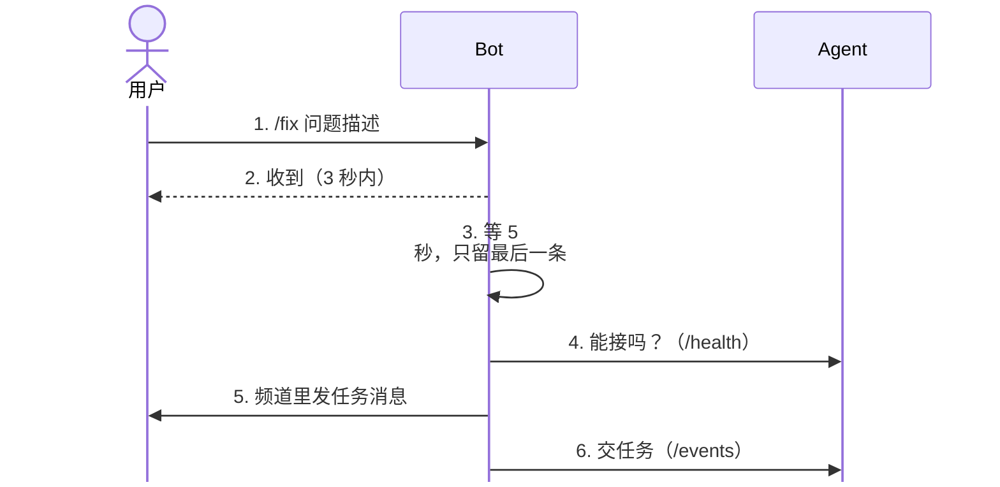
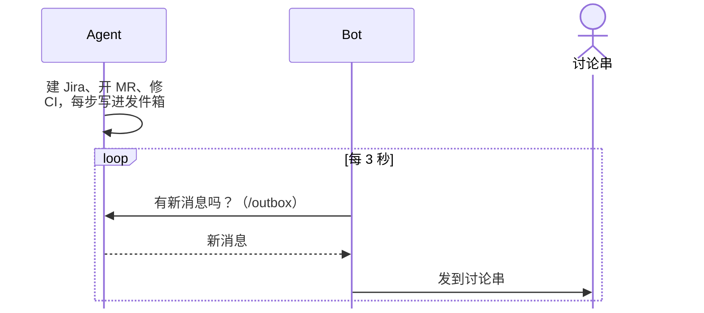

# Slack Bot 架构：`/fix` 怎么交给 Agent、进度怎么回来、出错怎么恢复

- 日期：2026-11-13
- 状态：4.1–4.5 的“拟改”已在 PR #7（分支 `AIINITIATIVES-5729-slackbot_fix_entry`）的 Bot 代码里实现，只通过单元测试；“当前实现”一栏保留，说明改之前的行为。第 5 节的字段在 PR #8 加上；Bot 对没有这些字段的旧版 Agent 照旧运行。4.8 发起人身份：Zihui 11-13 回复 Agent 不需要 `users:read`，发起人只写进 Jira 和 MR 描述，用 `/fix` 带的用户 ID 和名字。
- 范围：只讲 `src/slackBot/`（下文 **Bot**）和 Chat-to-Fix 服务（下文 **Agent**）之间怎么协作。入口文案和情况表见 [固定频道 `/fix` 规格](../../../spec/slack-fix-command.md)，接口字段见 [slackbot.md](slackbot.md) 4.2。

## 1. 前提

- 用户懂产品、懂问题，一次 `/fix` 把问题说全（Logan 11-13）。只额外处理一种情况：**发出去马上觉得不对，立刻发一条对的**。
- 不读讨论串：Slack 应用只有 `commands`、`chat:write`，不订阅事件。用户在讨论串里回复，Bot 收不到。
- Bot 和 Agent 在同一台机器上，走本机 HTTP（`127.0.0.1:3090`，头 `x-chat-to-fix-token`）。同一个 Slack 应用只让 Bot 一个程序连 Socket Mode。

## 2. 两个进程各管什么

| | Bot（`src/slackBot/`） | Agent（`src/chat-to-fix/`） |
|---|---|---|
| 管 | 收 `/fix`、防抖、发任务消息、交给 Agent；拉发件箱发到讨论串 | 排队、建 Jira、改代码、开 Draft MR、CI 修复；决定对用户说什么，写进发件箱 |
| 不管 | 不判断问题内容，不碰 Jira、GitLab，不写进度文案 | 不连 Slack，没有 Slack token |
| 状态 | 进程内：防抖计时、`trigger_id` 去重；文件：发件箱游标 | 任务、队列、发件箱（`outbox.jsonl`） |

**队列只有一个，在 Agent。** Bot 收到就交，不自己排队。Agent 默认一次跑 1 个任务、最多排 20 个，满了拒收（`core/config.ts`）。理由：再在 Bot 里加一层队列，两边状态会分裂，Bot 重启时队列里的请求会丢。公司内的 Slack 应用（Neuronet、git-access、whoisoncall、duty-monkey）和外部同类产品（Devin、Cursor、Copilot、OpenHands）都没有在入口前再排一层队。

**只跑一个 Bot 进程、一个 Socket Mode 连接。** 公司内的 Slack 应用都是单副本单连接（git-access README “one replica”），避免同一条命令被分到不同连接上重复处理。

## 3. 时序

分两段，各自独立运行。

**① 提交：用户发 `/fix`，Bot 交给 Agent**

第 4 步不能接（服务不通、队列满、频道不对）时，只给本人回一条临时消息，不走 5、6。第 6 步超时见 4.2。

**② 回传：Agent 的进度经发件箱发到讨论串**

Bot 每发出一条就记一次游标，重启后从游标接着发（4.4）。

## 4. 规则

### 4.1 同一个人连发多条（防抖）

| | 行为 |
|---|---|
| 当前实现 | 没有防抖，每条 `/fix` 各建一个任务 |
| 拟改 | 以“用户 + 频道”为键，收到 `/fix` 先 ack，再等 5 秒。5 秒内同一人又发了，就以新的一条为准、重新计时；被替代的那几条各回一条临时消息“已被你后一条 /fix 替代”。最后一条静默满 5 秒后，才查健康、发任务消息、交给 Agent |

- 后发覆盖先发，不合并：每条 `/fix` 都是完整描述，合并会把更正前后的话拼在一起。公司的 Neuronet Slack bot 只对普通聊天消息做合并式防抖，斜杠命令和指令类消息都不合并，代码注释给的原因是合并会让第二条指令丢失（`xsolla/neuronet` `src/slack/monitor/message-handler.ts`）。
- 公司内其他 Slack 应用都没有按用户防抖，只靠幂等。这里加 5 秒窗口，是为了 Logan 提的“发错马上更正”这一个场景。
- 被替代的请求还没交给 Agent，所以不会建 Jira 单，不用事后停任务。
- 代价：每次 `/fix` 要多等 5 秒才出现任务消息。
- 超过 5 秒再发，就是一个新任务。之前的任务照常跑；要停由人处理。

### 4.2 交给 Agent 后超时（Logan 规则 1）

| | 行为 |
|---|---|
| 当前实现 | `POST /events` 超时或连不上，都在讨论串说“服务暂时连不上，这次请求没有开始处理”。实际上超时时 Agent 可能已经建了任务，用户照提示重发会带新的 `trigger_id`，重复建单 |
| 拟改 | 用**同一个 `eventId`** 重发一次（隔 2 秒）。Agent 按 `eventId` 去重，已建过的返回原 `taskId`（`200`，`duplicate: true`），不会建第二个任务 |

重发后的结果：

| 结果 | Bot 做什么 |
|---|---|
| `202` 或 `200 duplicate` | 正常，进度由发件箱回来 |
| `4xx` | 不说话，Agent 已把说明放进发件箱（如频道未绑定、队列满） |
| 仍然**连不上**（请求没到 Agent） | 讨论串里说“服务暂时连不上，这次请求没有开始处理，请稍后再 /fix” |
| 仍然**超时**或 `5xx`（不知道 Agent 收没收到） | 讨论串里说“请求可能已经开始处理，请先看本讨论串后面的消息，不要重复提交” |

### 4.3 Bot 和 Agent 的频道不一致（Logan 规则 2）

| | 行为 |
|---|---|
| 当前实现 | 两边各读 `CHAT_TO_FIX_SLACK_CHANNEL`；Agent 没配时用本机频道 `CLOCAL`。对不上时，要等有人发 `/fix`，Agent 才返回 `422 channel_not_bound` |
| 拟改 | Agent 的 `GET /health` 返回绑定的频道 `channels`。Bot 启动时查一次：查到了且不包含自己的频道，就打日志并退出；Agent 没开，先照常启动。之后每次 `/fix` 本来就要查 `/health`，频道不对时只给本人回临时消息“机器人配置有误，请联系维护人员”，不发任务消息 |

### 4.4 首次启动或游标丢了（Logan 规则 3）

| | 行为 |
|---|---|
| 当前实现 | 游标是一个数字，存在 `src/slackBot/.data/outbox-cursor`。没有游标时跳到发件箱最新一条。Agent 数据目录清空后 seq 从 1 重来，Bot 游标偏大，之后的新消息会被**静默跳过** |
| 拟改 | 发件箱带一个编号 `outboxId`（Agent 建发件箱时随机生成，数据目录清空后会变）。`GET /outbox` 返回 `outboxId` 和 `lastSeq`。Bot 游标存 `{ outboxId, seq }` |

| 情况 | Bot 怎么处理 |
|---|---|
| 没有游标文件（第一次启动、文件丢了） | 从 `lastSeq` 开始，不重发历史。**已知缺口**：游标丢失期间新写进发件箱的消息会漏发，日志写明跳过了几条 |
| `outboxId` 和游标里的不一样 | 发件箱被重置过，从 0 开始：新发件箱里的都是还没发过的 |
| 同一个 `outboxId`，但游标 > `lastSeq` | 不应出现；打日志，改为 `lastSeq` |
| 旧格式游标（只有数字） | 当作同一个发件箱，保留 seq，补上当前 `outboxId` |

投递是“至少一次”：发完一条、还没存游标就崩溃，重启后这条会再发一次。

### 4.5 提交后想补一句话

不接。任务消息里写明“要补充或修改，请重新 /fix 并写完整描述”。Bot 收不到讨论串里的回复，没法接住补充。

以后要支持讨论串里追加：Agent 已经支持（`POST /events`，`source: "mention"`）。做成开关，默认关；打开要给 Slack 应用加 `app_mentions:read` 并订阅事件。

### 4.6 很多人同时发

不同的人互不影响，各走 4.1 的防抖，再交给 Agent 排队。队列满时，`/health` 的 `queueFull` 为真，Bot 只给本人回临时消息“修复队列已满，请稍后再试”（当前已实现）。

### 4.7 出错要让用户知道

Bot 自己处理不了的情况，都给用户一句看得懂的话（临时消息或讨论串），不只写日志。公司内的反例是 duty-monkey 出错只记日志，用户什么也看不到。

### 4.8 发起人身份（待 Logan 确认用途）

| | 行为 |
|---|---|
| 当前实现 | Bot 传给 Agent 的 `user` 是 `{ id, name }`：`id` 是 Slack 用户 ID；`name` 来自命令里的 `user_name`，Slack 官方已弃用、不要依赖。Agent 建 Jira 和 MR 都不设报告人或经办人，发起人只由模型写进 Jira 描述 |
| 拟改 | 按公司通行做法（git-access、whoisoncall、Neuronet）：Bot 用 `user_id` 调 `users.info` 取 `profile.email`，校验是 `@xsolla.com`、不是机器人或访客，再随 `user` 一起传给 Agent。查不到邮箱就给本人回临时消息，不发任务消息 |

- 需要给 Slack 应用加 `users:read`、`users:read.email`。缺 `users:read.email` 时 Slack 不报错，只是不返回邮箱（`xsolla/neuronet` `src/slack/slash-commands/neuronet-agent/job-steps.ts`），所以 Bot 要把“没有邮箱”当成配置错误处理。
- 只写进描述：Agent 直接用名字和邮箱。
- 要设 Jira 报告人、MR assignee：Agent 再用邮箱查账号。GitLab 用 `GET /users?search=<邮箱>` 后逐个精确比对邮箱，查不到再用邮箱 `@` 前面的部分当用户名查（git-access 的做法）；Jira 按邮箱查。都查不到就明确说明，不猜。这部分是 Agent 侧改动。

## 5. 要 Agent 加的字段

只加字段，不改已有字段和返回码。

| 接口 | 加什么 | 说明 |
|---|---|---|
| `GET /health` | `channels: string[]` | 配置里绑定的频道 ID（`bindings[].channel`） |
| `GET /outbox` | `outboxId: string` | 发件箱编号。建议存成数据目录里的 `outbox-id` 文件，第一次用时生成随机 UUID，之后不变；数据目录清空就重新生成 |
| `GET /outbox` | `lastSeq: number` | 当前最大 seq，发件箱为空时为 `0`；和本次返回的 `messages` 无关 |

若 4.8 定下来，`POST /events` 的 `user` 再加 `email`（可选字段，不改已有字段）。

## 6. Slack 应用权限

| 权限 | 用途 | 状态 |
|---|---|---|
| `commands` | 收 `/fix` | 需要 |
| `chat:write` | 发任务消息和讨论串回复 | 需要 |
| `users:read`、`users:read.email` | 4.8 拿发起人邮箱 | 待 Logan 确认；公司内多个应用已获批 |
| App-level token `connections:write` | Socket Mode | 需要 |

加权限要在 #it-help-desk 申请审批，首次响应最长 4 个工作日，最好一次申请齐。

## 7. 依据

- Slack 官方：斜杠命令 3 秒内 ack；`response_url` 30 分钟内最多 5 次，长任务用 `chat.postMessage` 发讨论串；`chat.postMessage` 每频道约 1 条/秒，超了按 `Retry-After` 重试；`user_name` 已弃用。
- 幂等重试：Stripe、AWS 官方都建议超时后用同一个幂等键重发，不换新键。
- 游标带编号：参考 Kafka KIP-516（topic ID），用编号识别“同名但已重建”的日志。
- 公司内部代码（Neuronet 代码索引）：`xsolla/neuronet` 的 `src/slack/`；GitLab `infrastructure-automation/k8s/git-access`、`infrastructure-automation/slack-apps/whoisoncall-slack`、`infrastructure-automation/slack-apps/duty-monkey-slack`。

## 8. 不在本文范围

- 真实 Slack 上的验收：等 Slack 应用安装审批和 Bot token。
