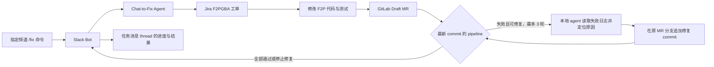

# Chat-to-Fix Agent 实施计划

目标工作流的最终指导版本见[从 Jira 到交付：工作流](from-jira-to-ship-workflow.zh.md)。本文记录当前实施路径和验收状态。开发应尽量遵循目标工作流；遇到无法避免的问题时，记录偏离原因、影响和实际做法，再更新本计划。目标工作流不代表当前代码已经具备相应能力。

下列里程碑状态最后核对于 2026-11-13。**M0：配置固定频道 `/fix` 入口已通过验收。**真实 Slack 联调已跑通一次命令到 Jira、Draft MR 和任务讨论串回报；CI 在可选作业仍运行时提前宣告通过，M6 尚未验收。整体功能尚未完成。

## 与目标工作流的待对齐项

| 目标工作流 | 本计划当前路径 | 后续处理 |
| --- | --- | --- |
| Jira 工单进入 `In Progress` 后调用 Agent | 当前以 Slack `/fix` 创建工单并启动任务 | 明确 Jira 状态触发与 Slack 入口的关系。 |
| 先建立 `T1`、由独立 Agent 会话识别 `T2`，在自动创建的 Stage 环境运行测试 | 当前计划主要依赖分支测试和 MR pipeline | 落实人工维护的代码文件到测试套件映射、`T2` 只增不删和 MR 展示；确定用例锁定、Stage 创建与验收方式。 |
| 测试通过后再创建 MR；失败时将日志和 Draft MR 写入工单并转人工 | 当前计划先创建 Draft MR，再观察 CI 并修复 | 明确 MR 创建时机与失败交接规则。 |
| 人工确认代码后由 Agent 合并到 `master` | 当前规则由团队审查和合并 MR | 在实现自动合并前确认权限、人工确认信号和失败处理。 |

这些差异尚未完成方案调整或验收，不视为已落实的功能。

## 整体目标

用户在指定 Slack 频道输入 `/fix 问题描述`。Slack Bot 将命令交给 Chat-to-Fix Agent。Agent 在 Jira `F2PGBA` 项目创建工单，修改 GitLab `account-platform/free-to-play-pc` 仓库代码，创建 Draft MR，并观察该 MR 的 CI/CD pipeline。失败时，Agent 读取具体日志，针对失败原因在原 MR 分支追加修复 commit，最多自动修复 3 轮。Agent 将关键进度和最终结果发回频道中任务消息的 thread，并更新 Jira 工单。团队审查和合并 MR。入口规则见 [固定频道命令规格](../spec/slack-fix-command.md)。

Slack Bot 负责接收 `/fix`、提交任务和发送进度。Chat-to-Fix Agent 负责 Jira、GitLab、代码修改与 CI 轮询。Jira 和 GitLab 使用各自的授权；Slack OAuth 权限不授予这些系统的访问权。

## 里程碑

| 里程碑 | 当前状态 | 验收标准 |
| --- | --- | --- |
| M0a 旧版模拟私信入口 | 已完成，仅作历史测试工具 | 无 Slack token 时，可通过本机接口提交模拟私信、读取原 thread 回复；相同事件只处理一次。行为见 [模拟 Bot 规格](../spec/mock-slack-bot.md)。 |
| M0 固定频道 `/fix` 配置 | 已完成：指定频道发信成功 | Bot scopes 为 `commands`、`chat:write`、`users:read`、`users:read.email`，User scopes 为空；无消息事件，关闭私信标签和 Slack MCP；注册 `/fix`；确定唯一允许的频道 ID；验证已安装 Bot token 具有这四项 scopes。真实调用在 M6 验收。 |
| M1 Bot 与本地 agent 对接 | 本机模拟入口已通过接口验收；真实 Slack 的一次命令已建立单个任务，重投去重待验收 | 模拟入口改为 `/fix` 任务输入；将问题正文、发送者和频道标识交给 agent；异步状态可追踪；相同命令不会重复启动任务。 |
| M2 Jira 工单 | 一次真实 Slack 任务已创建 F2PGBA-410 并在原讨论串回报；失败路径待验收 | 每个任务在 `F2PGBA` 创建一个工单；Slack thread 收到工单编号、链接和摘要；失败时报告具体原因。 |
| M3 代码修改与 Draft MR | 一次真实 Slack 任务已只修改 README.md，创建 Draft MR !379，并向 Slack 与 Jira 回写链接 | Agent 在 `account-platform/free-to-play-pc` 的任务分支修改代码和相关测试，创建一个 Draft MR，并在 Slack 与 Jira 记录链接。 |
| M4 CI 观察与修复 | 进行中：MR 来源筛选已修复；真实联调又确认可选作业运行时提前报告通过，失败修复循环未验收 | 只按当前 MR commit 的最新 pipeline 判定；读取失败检查的具体日志；在原 MR 分支最多追加 3 轮修复 commit；每轮检查新 pipeline。 |
| M5 模拟入口端到端验收 | 进行中：T-1 完成；T-12 误报 CI 通过，需修复后重新验收 | 从模拟 `/fix` 到 Jira、Draft MR、CI 结果、thread/Jira 回报的整条链路通过验证；失败路径明确报告阻塞；无凭据进入仓库或聊天记录。 |
| M6 真实 Slack 切换与验收 | 已验证空正文提示和一次有效命令到 Jira、Draft MR、讨论串回报；CI 提前结论、其他频道拒绝及重投去重待验收 | 工作区安装采用新 scopes 并取得 Bot token；真实 Bot 仅接受指定频道的 `/fix`，其他频道拒绝；验证命令到最终回报的链路。 |

## M0 验收记录

应用已获工作区批准。已配置的 Bot token 通过 Slack `auth.test`，响应列出四项预期 scopes，见 [Done](done.md)。验收结果如下：

- [x] 确定指定频道及其 ID；写入本机 `.env.local` 和 `.env.example`。
- [x] 确保 Bot 可在该频道发消息。首次测试返回 `channel_not_found`；加入应用后，`chat.postMessage` 返回 `ok: true` 且频道一致。
- [x] 用户确认工作区批准；本机 Bot token 通过 Slack `auth.test`，响应列出四项预期 scopes。审批人端的旧待审记录是否取消尚未核对。

M0 已通过验收。M6 已完成部分真实调用验证，仍未通过整体验收。已完成事项见 [done.md](done.md)。

用户要求在真实 Slack 配置尚未完成时先建立本机模拟频道。M1 的本地接口部分已独立验证：页面转发 `/fix` 到 Agent 的实际 HTTP 接口，并读取发件箱和任务状态；重复事件只启动一个任务。M0 的外部配置现已通过验收。本机模拟测试未提交真实 Jira 或 GitLab 写入。

根目录 `package.json` 直接调用两个独立入口：`npm start` 依次在后台启动 Agent 和模拟页面，`npm stop` 停止两者。Agent 已运行时，启动入口用当前数据目录的 token 验证其健康状态，然后继续启动页面。隔离端口验证了现有 Agent 加新页面的启动输出和 `CLOCAL`。旧模拟页面已停止，默认 4001 端口待复测。当前 3090 的旧 Agent 仍在运行，但其 PID 文件缺失；当前执行环境不能发送停止信号，需要在本机 Terminal 停止该旧进程。新版停止命令对此明确报错，保留无法确认已停止的 PID 文件。2026-11-13 再次读取其 `/health`，返回的频道仍不是新目标频道。此项不阻止 M0 的 Slack 配置工作；真实接入前必须按新配置重启 Agent 并核对频道。真实 Slack Bot 接入后，再调整 `package.json` 的启动入口。

接入代码已提前准备：`src/chat-to-fix/scripts/connected.ts` 复用根目录的 GitLab、Jira 和 Slack 变量，并为 Agent 生成独立配置。Bot 已加入指定频道；一次真实 `/fix` 已验证 Jira 与 GitLab 写入。完整 CI 循环仍需修复并重新验收。

## M6 真实 Slack 联调记录

2026-11-13 在 `#ai-intern-logan-team` 用浏览器提交空正文 `/fix`，Bot 返回仅发起者可见的用法提示，频道没有新增任务消息。随后提交一条限定只修改 F2P README 的测试请求。Bot 只创建一条任务消息，并在同一讨论串回报收到请求、[F2PGBA-410](https://xsolla.atlassian.net/browse/F2PGBA-410)、[Draft MR !379](https://gitlab.loc/account-platform/free-to-play-pc/-/merge_requests/379) 和最终结果。MR 仅增加一条与 `package.json` 相符的开发命令说明，未合并。Agent 也向 Jira 写入 MR 和结果。

Agent 在 [MR pipeline 1937953](https://gitlab.loc/account-platform/free-to-play-pc/-/pipelines/1937953) 的 `sonar` 作业仍运行时，向 Slack 与 Jira 宣告“CI 通过”并结束任务。该 pipeline 稍后确实成功，但通知时机错误；23:11 已在原 Slack 讨论串补发说明。原因和验收条件见[可选作业运行时提前报告 CI 通过](../docs/issues/gitlab-optional-job-premature-ci-pass.md)。这次测试没有覆盖其他频道拒绝、重投去重或 CI 失败修复。

测试使用独立数据目录和本机 `3199` 端口；真实 Slack Bot 已停止。测试 Agent 的停止请求被当前执行环境拒绝，因此它仍在本机端口运行，且不再连接 Slack。原 `3090` Agent 的 `/health` 仍绑定 `CLOCAL`。

## 执行规则

- Bot 收到 `/fix` 后先确认接收，再异步执行长任务。保存 Slack 命令、任务、Jira 工单和 MR 的对应关系。
- 对 Slack 命令重试和外部 API 请求做去重。重试不得重复创建工单或 MR。
- Bot 在任务消息的 thread 回报已接收、工单、MR、CI 修复轮次和最终结果。回复只给链接与结论，不粘贴完整 CI 日志或凭据。
- 只用当前 MR commit 对应的最新 pipeline 判定结果。旧 pipeline 的成功不能代表新 commit 通过。
- 无法从日志定位、修复超出工单范围、无法自动修复，或第 3 轮后仍失败时，停止并报告阻塞。
- Agent 不自动合并 MR。团队负责审查和合并。
- 每次只推进一个里程碑；按该里程碑的验收标准验证并更新本文件。

## 待确定的实施接口

- M1 已使用本机 HTTP `POST /events` 接收任务、`GET /outbox` 回传消息；模拟 Bot 一侧已通过本机接口测试，真实 Slack Bot 待 M6 接入。
- 长任务状态与去重记录的存储位置。
- M2 的 Jira 接口已用个人账号的新 token 验证：真实创建 `Task` 工单、新增并修改自身评论、回读评论，以及在目标 board 查到工单。`Work type` 必填，启动服务时需配置其字段 ID，任务输入需提供合适的值。M2 还需接入 Slack 任务去重、创建失败处理和工单链接回报。正式服务身份仍待确定。见 [Jira 接入记录](../config/jira/README.md)。
- GitLab 项目 token 已配置，客户端已通过真实只读 MR／CI 验证。模拟任务 T-1 已在安全任务分支验证 Git push 和 Draft MR 创建；标题／描述更新仍待验证。验证 MR 保持 Draft，不合并，见 [GitLab 接入记录](../config/gitlab/README.md)。
- Agent 的连接准备脚本复用 `createGitlabConnection()` 做只读检查；任务运行时使用自己的 GitLab 适配器。真实分支推送和 Draft MR 创建已验证，CI 修复提交仍待验证。
- M4 前确认同一 commit 出现多条 pipeline 时如何选择最新一条，并验证失败日志读取、修复 commit 和新 pipeline 的完整循环。

这些事项在对应里程碑开始前确定并验证。真实 Slack 的当前目标是 [固定频道 `/fix` 入口](../spec/slack-fix-command.md)。
