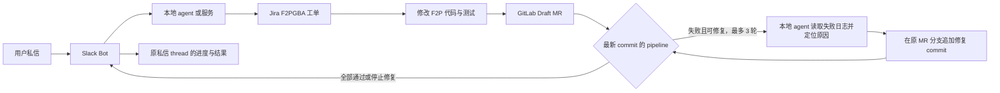

# Chat-to-Fix Agent 实施计划

更新日期：2026-11-12。当前里程碑：**M0 Slack 私信入口**。整体功能尚未完成。

## 整体目标

用户向 `Chat-to-Fix` 发送问题私信。Slack Bot 将消息交给本地 agent 或服务。Agent 在 Jira `F2PGBA` 项目创建工单，修改 GitLab `account-platform/free-to-play-pc` 仓库代码，创建 Draft MR，并观察该 MR 的 CI/CD pipeline。失败时，Agent 读取具体日志，针对失败原因在原 MR 分支追加修复 commit，最多自动修复 3 轮。Agent 将关键进度和最终结果发回原 Slack 私信 thread，并更新 Jira 工单。团队审查和合并 MR。

Slack Bot 只负责接收私信、提交任务和发送进度。本地 agent 或服务负责 Jira、GitLab、代码修改与 CI 轮询。Jira 和 GitLab 使用各自的授权；Slack OAuth 权限不授予这些系统的访问权。

## 里程碑

| 里程碑 | 当前状态 | 验收标准 |
| --- | --- | --- |
| M0 Slack 私信入口 | 进行中 | Slack 应用只订阅 `message.im`，Bot 权限只有 `im:history` 和 `chat:write`；完成工作区安装与 token 配置；测试私信只被处理一次，并在原 thread 收到确认。 |
| M1 Bot 与本地 agent 对接 | 未开始 | Bot 将问题正文、发送者、频道和 thread 标识交给 agent；异步任务状态可追踪；Slack 重试不会重复启动任务。 |
| M2 Jira 工单 | 未开始 | 每个任务在 `F2PGBA` 创建一个工单；Slack thread 收到工单编号、链接和摘要；失败时报告具体原因。 |
| M3 代码修改与 Draft MR | 未开始 | Agent 在 `account-platform/free-to-play-pc` 的任务分支修改代码和相关测试，创建一个 Draft MR，并在 Slack 与 Jira 记录链接。 |
| M4 CI 观察与修复 | 未开始 | 只按当前 MR commit 的最新 pipeline 判定；读取失败检查的具体日志；在原 MR 分支最多追加 3 轮修复 commit；每轮检查新 pipeline。 |
| M5 端到端验收 | 未开始 | 从测试私信到 Jira、Draft MR、CI 结果、Slack/Jira 回报的整条链路通过验证；失败路径明确报告阻塞；无凭据进入仓库或聊天记录。 |

## 当前里程碑 M0

- [ ] 等待工作区管理员批准安装，取得并安全保存 Bot OAuth token。
- [ ] 运行最小 Slack 测试 Bot，接收测试私信并在原 thread 回复一次。

当前阻塞：等待工作区管理员批准安装。M0 尚未通过验收。已完成事项见 [done.md](done.md)。

## 执行规则

- Bot 收到消息后先确认接收，再异步执行长任务。保存 Slack 消息、任务、Jira 工单和 MR 的对应关系。
- 对 Slack 事件和外部 API 请求做去重。重试不得重复创建工单或 MR。
- Bot 在原私信 thread 回报已接收、工单、MR、CI 修复轮次和最终结果。回复只给链接与结论，不粘贴完整 CI 日志或凭据。
- 只用当前 MR commit 对应的最新 pipeline 判定结果。旧 pipeline 的成功不能代表新 commit 通过。
- 无法从日志定位、修复超出工单范围、无法自动修复，或第 3 轮后仍失败时，停止并报告阻塞。
- Agent 不自动合并 MR。团队负责审查和合并。
- 每次只推进一个里程碑；按该里程碑的验收标准验证并更新本文件。

## 待确定的实施接口

- 本地 agent 的调用方式：进程、HTTP 服务或任务队列。
- 长任务状态与去重记录的存储位置。
- Jira board 的独立只读连接函数已完成本地测试。个人账号的最小读取权限 scoped token 已创建；仍需安全保存 token，并对目标 board 做真实 API 验证。正式服务身份仍待确定，见 [Jira 接入记录](../config/jira/README.md)。M2 创建工单与评论的 scopes 另行核对。
- GitLab 项目 token 已配置，客户端已通过真实只读 MR／CI 验证。M3 前仍需在安全的任务分支验证 Git push、Draft MR 创建和标题／描述更新；验证时不能合并 MR，见 [GitLab 接入记录](../config/gitlab/README.md)。
- M3 的本地 agent 直接复用独立的 `createGitlabConnection()`；还需验证 agent 到 GitLab 的调用链。当前 HTTP 服务不是写入入口。
- M4 前确认同一 commit 出现多条 pipeline 时如何选择最新一条，并验证失败日志读取、修复 commit 和新 pipeline 的完整循环。

这些事项在对应里程碑开始前确定并验证。它们不改变 M0 的 Slack 私信配置。
