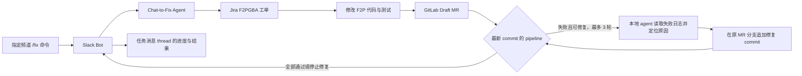

# Chat-to-Fix Agent 实施计划

更新日期：2026-11-12。**当前里程碑是 M0：配置固定频道 `/fix` 入口。**权限调整已完成；命令、频道和审批尚未完成。整体功能尚未完成。

## 整体目标

用户在指定 Slack 频道输入 `/fix 问题描述`。Slack Bot 将命令交给 Chat-to-Fix Agent。Agent 在 Jira `F2PGBA` 项目创建工单，修改 GitLab `account-platform/free-to-play-pc` 仓库代码，创建 Draft MR，并观察该 MR 的 CI/CD pipeline。失败时，Agent 读取具体日志，针对失败原因在原 MR 分支追加修复 commit，最多自动修复 3 轮。Agent 将关键进度和最终结果发回频道中任务消息的 thread，并更新 Jira 工单。团队审查和合并 MR。入口规则见 [固定频道命令规格](../spec/slack-fix-command.md)。

Slack Bot 负责接收 `/fix`、提交任务和发送进度。Chat-to-Fix Agent 负责 Jira、GitLab、代码修改与 CI 轮询。Jira 和 GitLab 使用各自的授权；Slack OAuth 权限不授予这些系统的访问权。

## 里程碑

| 里程碑 | 当前状态 | 验收标准 |
| --- | --- | --- |
| M0a 旧版模拟私信入口 | 已完成，仅作历史测试工具 | 无 Slack token 时，可通过本机接口提交模拟私信、读取原 thread 回复；相同事件只处理一次。行为见 [模拟 Bot 规格](../spec/mock-slack-bot.md)。 |
| M0 固定频道 `/fix` 配置 | 进行中：权限已调整 | Bot scopes 仅有 `commands`、`chat:write`，无消息事件；注册 `/fix`；确定唯一允许的频道 ID；核对安装申请采用新 scopes。真实安装和调用在 M6 验收。 |
| M1 Bot 与本地 agent 对接 | 本机模拟入口已通过接口验收；真实 Slack Bot 待 M6 | 模拟入口改为 `/fix` 任务输入；将问题正文、发送者和频道标识交给 agent；异步状态可追踪；相同命令不会重复启动任务。 |
| M2 Jira 工单 | 写入能力已验证，任务联动未开始 | 每个任务在 `F2PGBA` 创建一个工单；Slack thread 收到工单编号、链接和摘要；失败时报告具体原因。 |
| M3 代码修改与 Draft MR | 未开始 | Agent 在 `account-platform/free-to-play-pc` 的任务分支修改代码和相关测试，创建一个 Draft MR，并在 Slack 与 Jira 记录链接。 |
| M4 CI 观察与修复 | 模拟 CI 已实现，真实链路未验收 | 只按当前 MR commit 的最新 pipeline 判定；读取失败检查的具体日志；在原 MR 分支最多追加 3 轮修复 commit；每轮检查新 pipeline。 |
| M5 模拟入口端到端验收 | 未开始 | 从模拟 `/fix` 到 Jira、Draft MR、CI 结果、thread/Jira 回报的整条链路通过验证；失败路径明确报告阻塞；无凭据进入仓库或聊天记录。 |
| M6 真实 Slack 切换与验收 | 待审批 | 工作区安装采用新 scopes 并取得 Bot token；真实 Bot 仅接受指定频道的 `/fix`，其他频道拒绝；验证命令到最终回报的链路。 |

## 当前里程碑 M0

权限调整已完成，见 [Done](done.md)。本里程碑还需完成以下配置：

- [ ] 在 Slack 应用注册 `/fix` Slash Command。
- [ ] 确定指定频道及其 ID，并确保 Bot 可在该频道发消息。频道类型和 ID 尚未确定。
- [ ] 核对审批人看到的待审申请是否采用新 scopes；如未更新，按新权限重新提交申请。

本里程碑完成后再推进真实 Slack Bot 对接。管理员审批阻塞真实安装和 M6 验收。已完成事项见 [done.md](done.md)。

用户要求在真实 Slack 配置尚未完成时先建立本机模拟频道。M1 的本地接口部分已独立验证：页面转发 `/fix` 到 Agent 的实际 HTTP 接口，并读取发件箱和任务状态；重复事件只启动一个任务。M0 仍是当前未完成的外部配置里程碑。本机模拟测试未提交真实 Jira 或 GitLab 写入。

根目录 `package.json` 直接调用两个独立入口：`npm start` 依次在后台启动 Agent 和模拟页面，`npm stop` 停止两者。Agent 已运行时，启动入口用当前数据目录的 token 验证其健康状态，然后继续启动页面。隔离端口验证了现有 Agent 加新页面的启动输出和 `CLOCAL`。当前开发机的默认 4001 端口仍被旧版验证进程占用；命令现会明确打印可检查的页面地址，但不会接管该进程。当前运行的旧 Agent 没有 PID 文件，`npm stop` 无法管理该旧进程。清理旧进程后需在默认端口复测。此项不阻止 M0 的 Slack 配置工作。真实 Slack Bot 接入后，再调整 `package.json` 的启动入口。

接入代码已提前准备：`src/chat-to-fix/scripts/connected.ts` 复用根目录的 GitLab、Jira 和 Slack 变量，并为 Agent 生成独立配置。此项不改变 M0 的验收状态。真实 Slack 安装获批、频道 ID 确定后，才能完成真实入口验证；GitLab 写入和完整 CI 循环仍需真实环境验证。

## 执行规则

- Bot 收到 `/fix` 后先确认接收，再异步执行长任务。保存 Slack 命令、任务、Jira 工单和 MR 的对应关系。
- 对 Slack 命令重试和外部 API 请求做去重。重试不得重复创建工单或 MR。
- Bot 在任务消息的 thread 回报已接收、工单、MR、CI 修复轮次和最终结果。回复只给链接与结论，不粘贴完整 CI 日志或凭据。
- 只用当前 MR commit 对应的最新 pipeline 判定结果。旧 pipeline 的成功不能代表新 commit 通过。
- 无法从日志定位、修复超出工单范围、无法自动修复，或第 3 轮后仍失败时，停止并报告阻塞。
- Agent 不自动合并 MR。团队负责审查和合并。
- 每次只推进一个里程碑；按该里程碑的验收标准验证并更新本文件。

## 待确定的实施接口

- M1 已使用本机 HTTP `POST /events` 接收任务、`GET /outbox` 回传消息；模拟 Bot 一侧已通过本机接口测试，真实 Slack Bot 待 M6 接入。
- 长任务状态与去重记录的存储位置。
- M2 的 Jira 接口已用个人账号的新 token 验证：真实创建 `Task` 工单、新增并修改自身评论、回读评论，以及在目标 board 查到工单。`Work type` 必填，启动服务时需配置其字段 ID，任务输入需提供合适的值。M2 还需接入 Slack 任务去重、创建失败处理和工单链接回报。正式服务身份仍待确定。见 [Jira 接入记录](../config/jira/README.md)。
- GitLab 项目 token 已配置，客户端已通过真实只读 MR／CI 验证。M3 前仍需在安全的任务分支验证 Git push、Draft MR 创建和标题／描述更新；验证时不能合并 MR，见 [GitLab 接入记录](../config/gitlab/README.md)。
- Agent 的连接准备脚本复用 `createGitlabConnection()` 做只读检查；任务运行时使用自己的 GitLab 适配器。真实 GitLab 写入链路仍待验证。
- M4 前确认同一 commit 出现多条 pipeline 时如何选择最新一条，并验证失败日志读取、修复 commit 和新 pipeline 的完整循环。

这些事项在对应里程碑开始前确定并验证。真实 Slack 的当前目标是 [固定频道 `/fix` 入口](../spec/slack-fix-command.md)。
